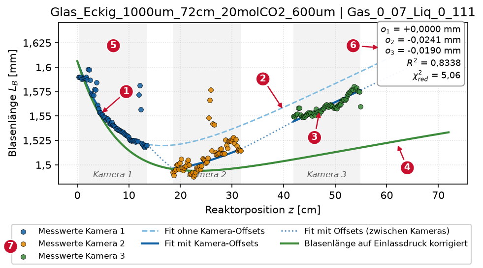
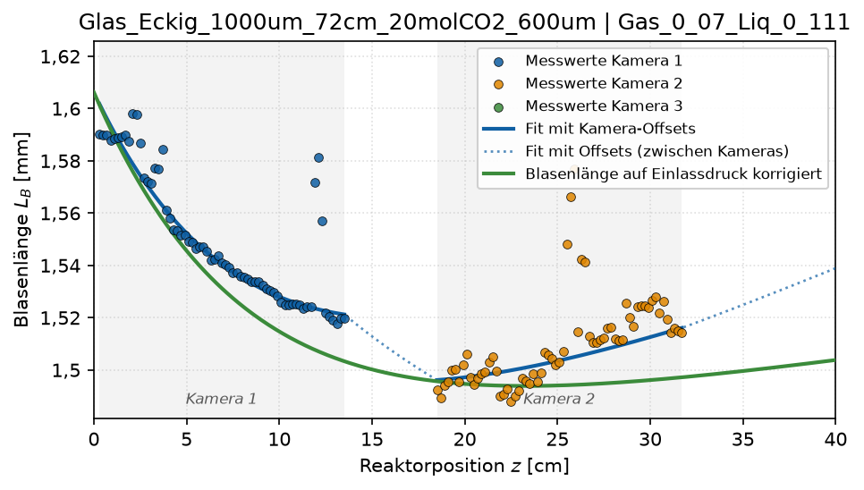
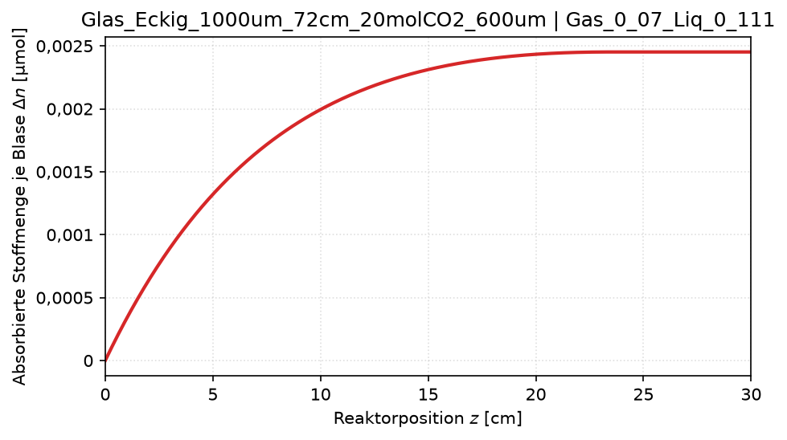
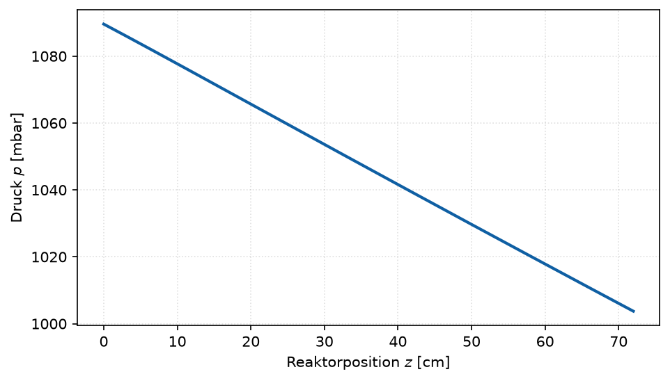
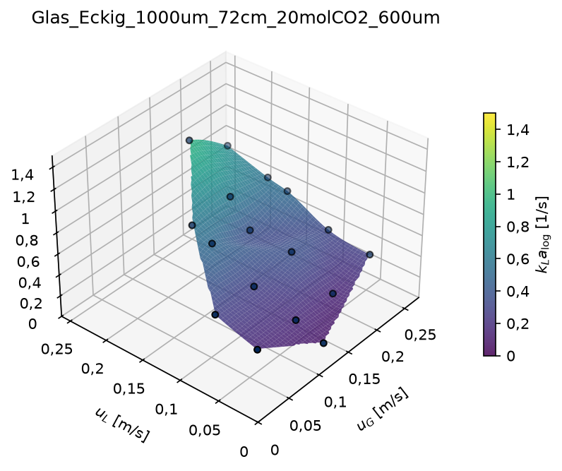
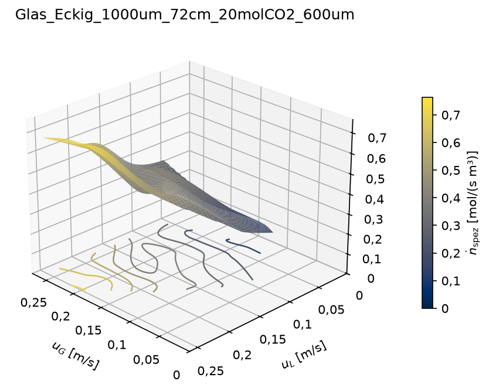
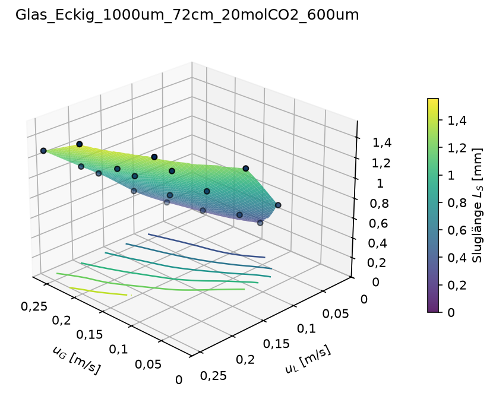
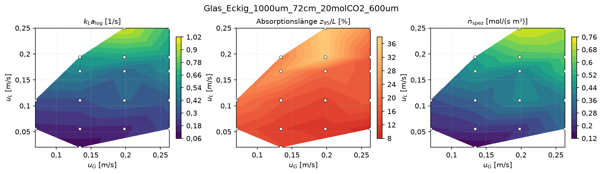

# 4 Plots auswählen und anpassen

## 4.1 Grundprinzip

`auswertung.py` erzeugt nach der Rechnung alle eingeschalteten Plots und legt
sie in `ergebnisse/<Kanal>/plots/` ab. Was erscheint und wie es aussieht,
steht an zwei Stellen in `config.py`:

| Abschnitt | Gilt für | Beispiele |
|---|---|---|
| `PLOTS` | je Plot ein eigener Block | ein/aus, Achsbereiche, Bildelemente, Farben, Farbskala, Heatmap-Felder |
| `STIL` | alle Plots gemeinsam | Sprache, Dateiformat, Auflösung, Schriftgröße, Standardgrößen, Titel ein/aus |

Jeder Block in `PLOTS` führt **alle** möglichen Einträge mit ihrem
Standardwert auf. Zum Anpassen wird nur der Wert geändert:

```python
PLOTS = dict(
    blasenlaengen_fit=dict(
        an=True, titel="auto", groesse_cm=None,
        x_bereich_cm=None,              # Reaktorposition z [cm]
        y_bereich_mm=None,              # Blasenlänge [mm]
        ...
```

Nach einer Änderung genügt ein Lauf mit `NEU_RECHNEN = False`
(Kapitel 3.5); die Plots sind dann in Sekunden neu gezeichnet.

**Für alle Plots gleich:**

| Eintrag | Bedeutung | Beispiel |
|---|---|---|
| `an` | Plot erzeugen | `an=False` |
| `titel` | `"auto"` = Kanalname (bzw. Kanal und Betriebspunkt), eigener Text oder `""` für ohne Titel | `titel="PVC, 1 mm"` |
| `groesse_cm` | (Breite, Höhe) in cm; `None` = Standardgröße aus `STIL` | `groesse_cm=(9, 7)` |
| Achsbereiche | `(min, max)` in der Einheit der Achse; `None` = automatisch | `x_bereich_cm=(0, 40)` |
| Farben | Name (`"tab:red"`, `"black"`) oder Hex-Code (`"#3B8B3B"`) | `farbe="tab:red"` |
| Farbskalen | Name einer matplotlib-Farbskala | `farbskala="viridis"` |

Gängige Farbskalen: `"plasma"`, `"viridis"`, `"cividis"`, `"magma"`,
`"coolwarm"`, `"RdYlGn"`, `"Blues"`. Mit der Endung `_r` wird die Skala
umgekehrt (`"viridis_r"`).

**Tippfehler** werden sofort gemeldet, mit allen möglichen Namen:

```
KeyError: "Unbekannte Option ['farbskale'] für den Plot 'kla_flaeche'.
Möglich: ['achsen', 'an', 'blickwinkel', 'farbskala', 'groesse_cm', ...]"
```

**Übersicht der Plots**

| Block in `PLOTS` | Plot | Datei | Abschnitt |
|---|---|---|---|
| `blasenlaengen_fit` | Blasenlänge entlang des Kanals mit Fit | `blasenlaenge_<Betriebspunkt>.png` | 4.2 |
| `stoffmenge` | absorbierte CO2-Menge je Blase | `stoffmenge_<Betriebspunkt>.png` | 4.3 |
| `druckprofil` | berechneter Druck entlang des Kanals | `druck_<Betriebspunkt>.png` | 4.4 |
| `kla_flaeche` | kLa_log_mean über u_G und u_L (3D) | `kla_flaeche.png` | 4.5 |
| `nspez_flaeche` | volumenspezifischer Molenstrom (3D) | `nspez_flaeche.png` | 4.6 |
| `modell_flaechen` | Vorhersage von Literatur- oder eigenen Modellen (3D) | `modell_<Modell>.png` | 4.7 |
| `spalten_flaechen` | beliebige Spalte der Ergebnistabelle (3D), standardmäßig aus | `flaeche_<Spalte>.png` | 4.8 |
| `heatmaps` | Kennzahlen-Übersicht als Farbkarten | `heatmaps.png` | 4.9 |

Die ersten drei Plots entstehen **je Betriebspunkt**; welche Betriebspunkte,
legt `BETRIEBSPUNKTE` fest (Kapitel 3.5). Die übrigen entstehen **je Kanal**.

## 4.2 Blasenlängen-Fit (`blasenlaengen_fit`)



| Nr. | Bildelement | Bedeutung | Eintrag |
|---|---|---|---|
| 1 | Punkte, farbig je Kamera | gemessene Blasenlängen je Bin | `messwerte` |
| 2 | hellblau gestrichelt | Fit **ohne** Kamera-Offsets; mit dieser Kurve wird weitergerechnet | `fit_ohne_offsets` |
| 3 | dunkelblau, zwischen den Kameras gepunktet | derselbe Fit plus Offset der jeweiligen Kamera; muss den Punkten folgen | `fit_mit_offsets` |
| 4 | grün | Blasenlänge auf den Einlassdruck umgerechnet; enthält nur noch die Absorption | `druckkorrigiert` |
| 5 | graue Bänder | Bereich der Messpunkte je Kamera | `kamerafenster` |
| 6 | Kasten | Kamera-Offsets o_j, R² und χ²_red des Fits | `kennwertkasten` |
| 7 | Legende | Erklärung der Linien | `legende` |

**Worauf achten:**

- Die dunkelblaue Kurve folgt den Punkten aller Kameras.
- Die grüne Kurve fällt und flacht ab. Ein Wiederanstieg weist auf ein zu
  niedrig berechnetes Druckprofil hin.
- Die Offsets betragen wenige hundertstel Millimeter. Bei Offsets in der
  Größe der Absorption warnt das Protokoll.
- χ²_red über etwa 3 heißt, dass das Modell die Streuung nicht vollständig
  erklärt. Einzelne Ausreißer (im Bild bei z ≈ 12 cm und 26 cm) dämpft der
  robuste Fit.

**Anpassen**

| Wunsch | Eintrag im Block `blasenlaengen_fit` |
|---|---|
| nur den vorderen Kanalabschnitt zeigen | `x_bereich_cm=(0, 40)` |
| feste y-Achse für mehrere Betriebspunkte | `y_bereich_mm=(1.4, 1.7)` |
| ohne den gestrichelten Fit | `fit_ohne_offsets=False` |
| nur Messwerte und Fit, ohne Druckkorrektur | `druckkorrigiert=False` |
| ohne graue Kamerabänder | `kamerafenster=False` |
| ohne Kasten mit Kennwerten | `kennwertkasten=False` |
| Legende im Plot statt darunter | `legende="innen"` (freie Stelle) oder z. B. `legende="upper right"` |
| ohne Legende | `legende="aus"` |

Mögliche Legendenpositionen: `"upper left"`, `"upper center"`,
`"upper right"`, `"center left"`, `"center"`, `"center right"`,
`"lower left"`, `"lower center"`, `"lower right"`.

Beispiel: links der Standard, rechts mit
`x_bereich_cm=(0, 40), fit_ohne_offsets=False, kennwertkasten=False, legende="upper right"`.

{width=49%} {width=49%}

## 4.3 Absorbierte Stoffmenge (`stoffmenge`)

Kumuliert absorbierte CO2-Menge je Blase in µmol über der Kanalposition.
Der Verlauf flacht ab, sobald die Flüssigkeit gesättigt ist oder das CO2
verbraucht ist.

| Wunsch | Eintrag im Block `stoffmenge` |
|---|---|
| Achsbereiche | `x_bereich_cm=(0, 30)`, `y_bereich_umol=(0, 0.5)` |
| ohne eingefärbte Fläche unter der Kurve | `flaeche=False` |
| andere Linienfarbe | `farbe="tab:red"` |

Links der Standard, rechts mit
`flaeche=False, farbe="tab:red", x_bereich_cm=(0, 30)`:

{width=49%} {width=49%}

## 4.4 Druckprofil (`druckprofil`)

Berechneter Absolutdruck, vom gemessenen Auslassdruck rückwärts integriert.
Die Steigung ist der Druckgradient des Bretherton- bzw. Kurimoto-Modells
(Kapitel 7.4).

| Wunsch | Eintrag im Block `druckprofil` |
|---|---|
| Druck in mbar, hPa, kPa oder bar | `einheit="mbar"` |
| Achsbereiche (y in der gewählten Einheit) | `x_bereich_cm=(0, 72)`, `y_bereich=(1000, 1100)` |
| andere Linienfarbe | `farbe="black"` |

Links der Standard, rechts mit `einheit="mbar", titel=""`:

{width=49%} {width=49%}

## 4.5 kLa-Fläche (`kla_flaeche`)

{width=75%}

- **Fläche:** kLa_log_mean über u_G und u_L, kubisch zwischen den
  Messpunkten interpoliert; außerhalb der Messpunkte bleibt sie leer.
- **Punkte:** die Messwerte. Bei wenigen, unregelmäßig verteilten Punkten
  kann die Interpolation über- oder unterschwingen; maßgeblich sind die
  Punkte.
- **Linien am Boden:** Höhenlinien.
- Betriebspunkte ohne gültigen kLa-Wert (`kla_ungueltig`) fehlen.

**Anpassen** (gilt genauso für alle 3D-Flächen, Abschnitte 4.6 bis 4.8)

| Wunsch | Eintrag |
|---|---|
| andere Farbskala | `farbskala="viridis"` |
| feste Achsbereiche, z. B. für den Vergleich mehrerer Kanäle | `achsen=dict(x=(0, 0.3), y=(0, 0.3), z=(0, 1.5))`; nicht genannte Achsen bleiben automatisch |
| andere Blickrichtung | `blickwinkel=(35, 220)`: Höhe und Drehung in Grad |
| ohne Messpunkte | `messpunkte=False` |
| ohne Höhenlinien | `hoehenlinien=False` |
| Fläche deckend bzw. durchsichtiger | `transparenz=1.0` bzw. `0.5` |

Für die Blickrichtung: Höhe 0° ist die Seitenansicht, 90° die Draufsicht;
die Drehung dreht den Plot um die senkrechte Achse (Standard `(25, 135)`).

Links der Standard, rechts mit
`farbskala="viridis", blickwinkel=(35, 220), achsen=dict(z=(0, 1.5)), hoehenlinien=False`:

{width=49%} {width=49%}

## 4.6 Volumenspezifischer Molenstrom (`nspez_flaeche`)

ṅ_spez [mol/(s·m³)]: absorbierter CO2-Molenstrom, bezogen auf das gesamte
Kanalvolumen (Definition in Kapitel 7.7). Der Bezug auf den ganzen Kanal
macht den Wert mit dem Monolithen vergleichbar; gesättigte Abschnitte zählen
deshalb mit. Optionen wie in 4.5.

Links der Standard, rechts mit
`farbskala="cividis", messpunkte=False, transparenz=1.0`:

{width=49%} {width=49%}

## 4.7 Modellflächen (`modell_flaechen`)

{width=75%}

Vorhersage eines Literatur- oder eigenen Modells für dieselben
Betriebspunkte, je Modell ein Bild. Die Modelle stehen in der Liste
`modelle`:

```python
modell_flaechen=dict(an=True, modelle=["yue_2007", "vandu"], ...)
```

Mögliche Namen: `van_baten_voll`, `van_baten_kappe`, `van_baten_film`,
`vandu`, `shao`, `liu_wang`, `heiszwolf`, `yao`, `yue_2007`, `yue_2009` und
alle eigenen Modelle aus `config/eigene_modelle.yaml` (Kapitel 9). Modelle,
die für die Kanalform nicht gelten (Yue nur eckig, Liu-Wang nur rund),
werden mit einem Hinweis übersprungen. Übrige Optionen wie in 4.5.

## 4.8 Beliebige Spalten als Fläche (`spalten_flaechen`)

Jede Zahlenspalte der Betriebspunkt-Tabelle (Kapitel 6.2) lässt sich als
3D-Fläche über u_G und u_L zeichnen. Der Block ist standardmäßig
ausgeschaltet. Je Eintrag in `spalten` entsteht ein Bild
`flaeche_<Spalte>.png`:

```python
spalten_flaechen=dict(
    an=True, ...,
    spalten=[
        dict(spalte="SlugLength_mean_m", beschriftung="Sluglänge $L_S$ [mm]", faktor=1000),
        dict(spalte="slip_meas_over_theo", beschriftung="Schlupf [-]"),
    ],
)
```

| Eintrag je Spalte | Bedeutung |
|---|---|
| `spalte` | Spaltenname wie in der Tabelle |
| `beschriftung` | Text an der Farbskala; ohne Angabe der Spaltenname. Formeln in `$…$` |
| `faktor` | Umrechnung vor dem Zeichnen, z. B. `1000` für m → mm |

{width=75%}

## 4.9 Kennzahlen-Übersicht (`heatmaps`)


Mehrere Größen als Farbkarten über u_G × u_L; die weißen Punkte sind die
Betriebspunkte. Die Übersicht eignet sich, um eine neue Messreihe schnell auf
Ausreißer zu prüfen. Standardfelder in Leserichtung:

| Name in `felder` | Größe |
|---|---|
| `"kla"` | kLa_log_mean |
| `"saettigung_aus"` | Sättigung C_L/C* am Kanalende |
| `"z95"` | Absorptionslänge: Position, an der 95 % der insgesamt absorbierten CO2-Menge aufgenommen sind, bezogen auf die Kanallänge |
| `"beta_ein"` | Gasanteil der Einheitszelle am Einlass, β = L_B/(L_B + L_S) |
| `"schlupf"` | gemessene Blasengeschwindigkeit / (u_G + u_L) |
| `"L_b_ein"` | gefittete Blasenlänge am Einlass |

**Anpassen**

| Wunsch | Eintrag im Block `heatmaps` |
|---|---|
| andere Auswahl oder Reihenfolge | `felder=["kla", "z95", "schlupf"]`; bis drei Felder je Zeile |
| eine Spalte der Betriebspunkt-Tabelle als Feld | `felder=["kla", "n_spez_mol_s_m3"]` |
| Überschrift eines Felds | `beschriftungen={"n_spez_mol_s_m3": "ṅ_spez [mol/(s m³)]"}` |
| Farbskala eines Felds | `farbskalen=dict(kla="viridis")` |

Beispiel mit drei Feldern:
`felder=["kla", "z95", "n_spez_mol_s_m3"]`, eigene Überschrift für
`n_spez_mol_s_m3` und `farbskalen=dict(kla="viridis")`:



## 4.10 Darstellung aller Plots (`STIL`)

| Eintrag | Standard | Bedeutung |
|---|---|---|
| `sprache` | `"de"` | `"de"` (Dezimalkomma) oder `"en"` (Dezimalpunkt, englische Beschriftung) |
| `formate` | `("png",)` | ein oder mehrere Dateiformate, z. B. `("png", "pdf")`; PDF und SVG sind verlustfrei skalierbar |
| `dpi` | 300 | Auflösung der PNG-Dateien |
| `schriftgroesse` | 10 | Grundschriftgröße in pt |
| `groesse_profil_cm` | (16, 9) | Standardgröße der Plots je Betriebspunkt |
| `groesse_3d_cm` | (14, 11) | Standardgröße der 3D-Flächen |
| `groesse_heatmaps_cm` | (30, 17) | Standardgröße der Kennzahlen-Übersicht (für 2 × 3 Felder) |
| `groesse_paritaet_cm` | (12, 11) | Paritätsdiagramme (Kapitel 9 und 11) |
| `titel_anzeigen` | `True` | `False` schaltet alle Titel ab, z. B. für Abbildungen in Arbeiten |
| `blickwinkel_3d` | (25, 135) | Standard-Blickrichtung der 3D-Flächen |

Der `STIL` gilt auch für `literaturvergleich.py`, `monolith.py` und
`kalibrierung.py`. Eine Größe im Block eines Plots (`groesse_cm`) hat
Vorrang vor der Standardgröße.

Links deutsch mit Titel (Standard), rechts mit
`sprache="en", titel_anzeigen=False`:

{width=49%} {width=49%}

## 4.11 Eine einzelne Abbildung erzeugen (`abbildung.py`)

Für eine Abbildung in einer Arbeit oder einem Vortrag braucht man oft genau
einen Plot in einer bestimmten Form, ohne `config.py` dauerhaft zu ändern.
Dafür gibt es `abbildung.py`. Oben in der Datei stehen nur wenige
Einstellungen:

```python
KANAL = "Glas_Eckig_1000um_72cm_20molCO2_600um"   # Ordnername in ergebnisse/
PLOT = "blasenlaengen_fit"                        # Name eines Blocks in config.PLOTS
BETRIEBSPUNKT = "Gas_0_134_Liq_0_056"             # nur für Plots je Betriebspunkt

ANPASSUNGEN = dict(                               # Änderungen gegenüber config.PLOTS[PLOT]
    x_bereich_cm=(0, 40),
    kennwertkasten=False,
    legende="upper right",
)
STIL_ANPASSUNGEN = dict(                          # Änderungen gegenüber config.STIL
    sprache="en",
    formate=("png", "pdf"),
    titel_anzeigen=False,
)
ZIEL_ORDNER = config.ERGEBNIS_ORDNER / "abbildungen"
DATEINAME = None        # None = Name wie in auswertung.py
VORSCHAU = True         # Abbildung zusätzlich in einem Fenster anzeigen
```

Dann `python abbildung.py` ausführen. Die Abbildung wird gespeichert und mit
`VORSCHAU = True` in einem Fenster gezeigt. In diesem Fenster lässt sie sich
vergrößern und verschieben; gespeichert ist die Fassung mit den Einstellungen
aus der Datei.

- Es wird nichts neu gerechnet. `auswertung.py` muss für den Kanal schon
  gelaufen sein.
- In `ANPASSUNGEN` sind alle Einträge des jeweiligen Blocks aus
  `config.PLOTS` erlaubt (Abschnitte 4.2 bis 4.9).
- Für `modell_flaechen` und `spalten_flaechen` entsteht je Modell bzw.
  Spalte ein Bild.

## 4.12 Rezepte

**Abbildung für eine Arbeit (schmal, englisch, Vektorgrafik).** In
`abbildung.py`:

```python
PLOT = "kla_flaeche"
ANPASSUNGEN = dict(groesse_cm=(8, 7), farbskala="viridis")
STIL_ANPASSUNGEN = dict(sprache="en", formate=("pdf",), titel_anzeigen=False, schriftgroesse=8)
```

**Mehrere Kanäle auf gleichen Achsen vergleichen.** In `config.py` für die
Fläche feste Achsen setzen, dann alle Kanäle auswerten bzw. neu zeichnen:

```python
kla_flaeche=dict(..., achsen=dict(x=(0, 0.3), y=(0, 0.3), z=(0, 1.5)), ...)
```

**Nur die Übersichtsplots, keine Plots je Betriebspunkt.** In `config.py`
`an=False` in den Blöcken `blasenlaengen_fit`, `stoffmenge` und
`druckprofil`.

**Eine weitere Größe als Fläche.** In `spalten_flaechen` `an=True` setzen
und die Spalte in `spalten` eintragen (4.8). Die verfügbaren Spalten listet
Kapitel 6.2.

**Kennzahlen-Übersicht mit eigener Auswahl.** `felder` im Block
`heatmaps` (4.9).

## 4.13 Plots direkt aus Python

Alle Plotfunktionen lassen sich auch selbst aufrufen. Sie geben eine
matplotlib-Figure zurück, die sich vor dem Speichern beliebig weiter
bearbeiten lässt:

```python
import config
from taylorflow import ergebnisse, plots

ordner = config.ERGEBNIS_ORDNER
kanal = "Glas_Eckig_1000um_72cm_20molCO2_600um"
bp = ergebnisse.lade_betriebspunkte(ordner, kanal)
profile = ergebnisse.lade_profile(ordner, kanal)
stil = plots.PlotStil(**config.STIL).mit(sprache="en")

fig = plots.kla_flaeche(bp, stil, titel="", farbskala="viridis", achsen=dict(z=(0, 1.5)))
fig.axes[0].set_zlabel("kLa [1/s]")              # beliebige matplotlib-Änderung
plots.speichere(fig, "abbildungen", "kla_glas", stil)

profil = ergebnisse.profil_eines_betriebspunkts(profile, "Gas_0_134_Liq_0_056")
zeile = bp[bp["Config"] == "Gas_0_134_Liq_0_056"].iloc[0]
fig = plots.blasenlaengen_fit(profil, zeile, stil, x_bereich_cm=(0, 40), legende="innen")
plots.speichere(fig, "abbildungen", "blasen_glas", stil)
```

Die Parameter jeder Funktion entsprechen den Einträgen der Blöcke in
`config.PLOTS`; `help(plots.blasenlaengen_fit)` zeigt sie an.
