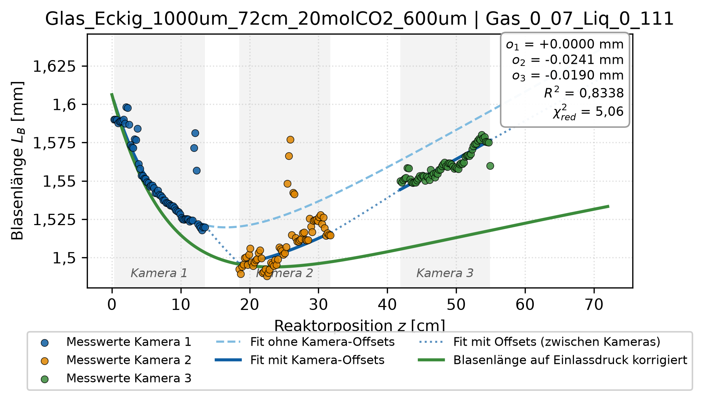
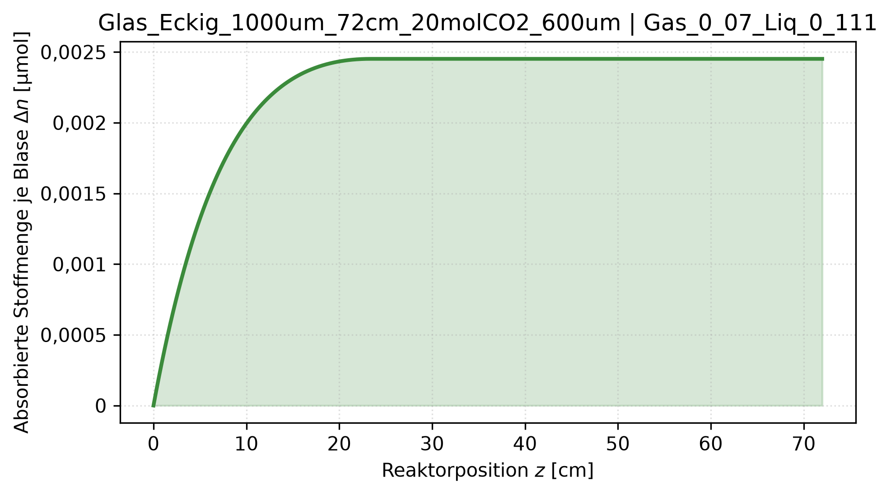
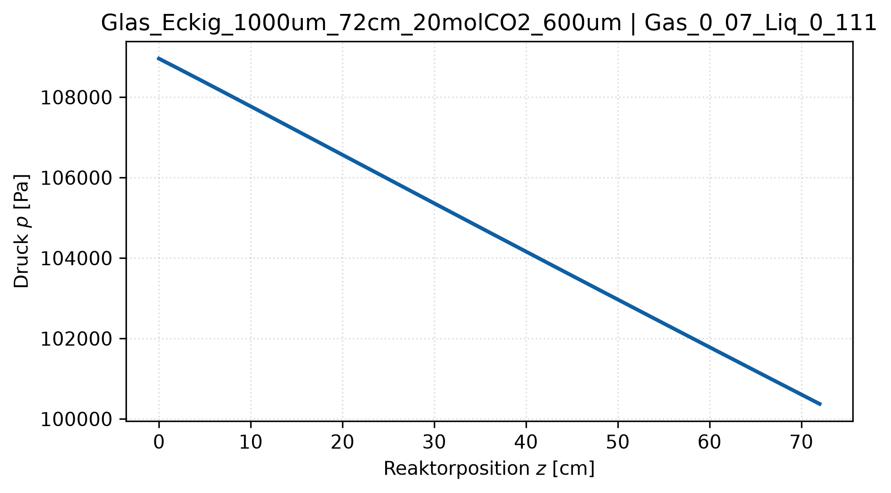
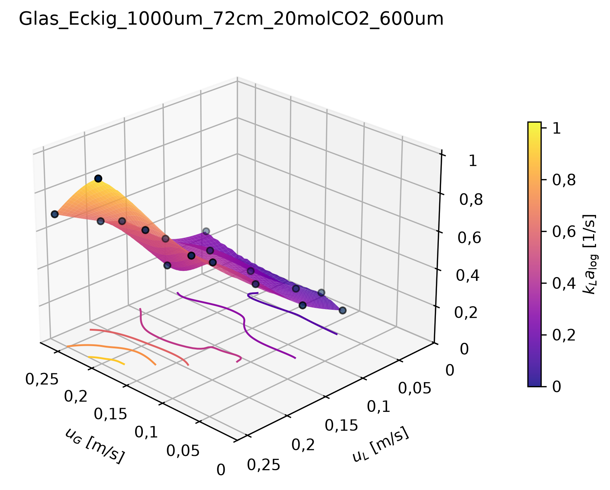
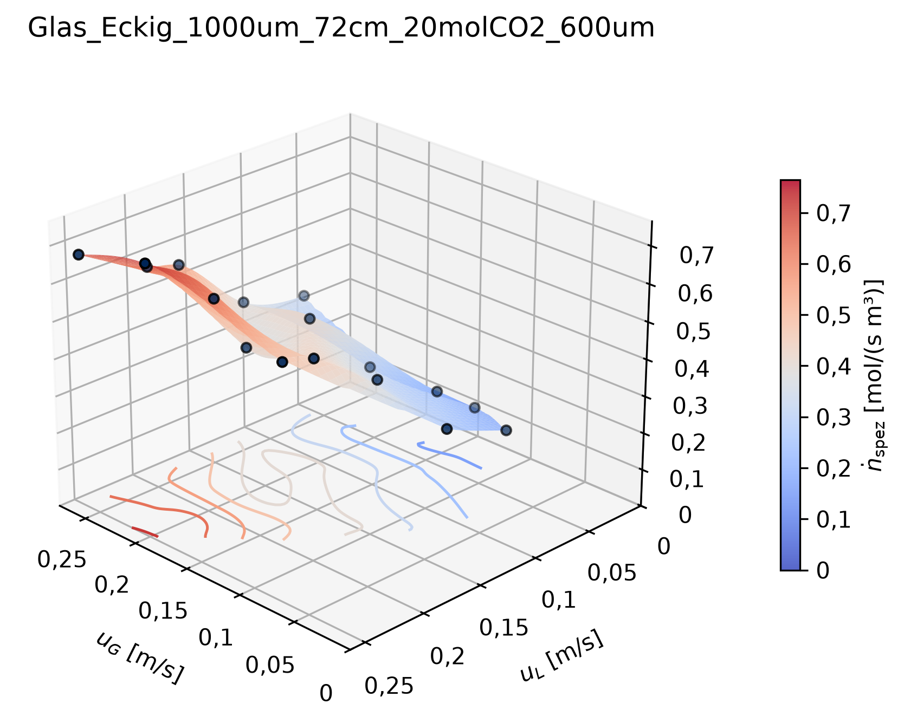
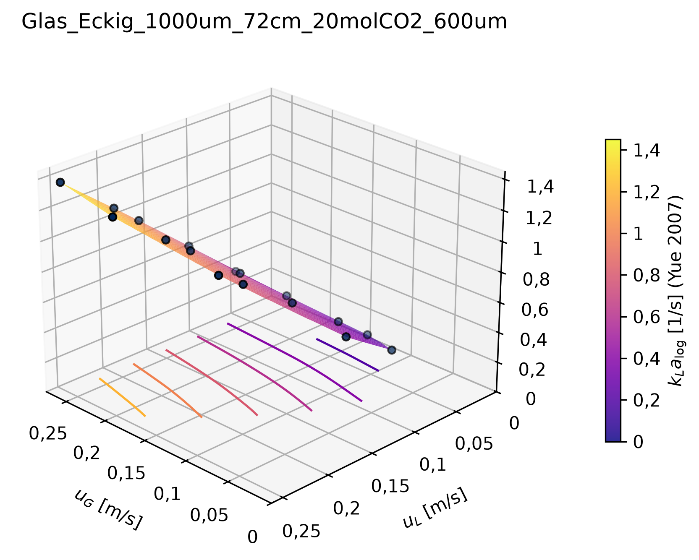
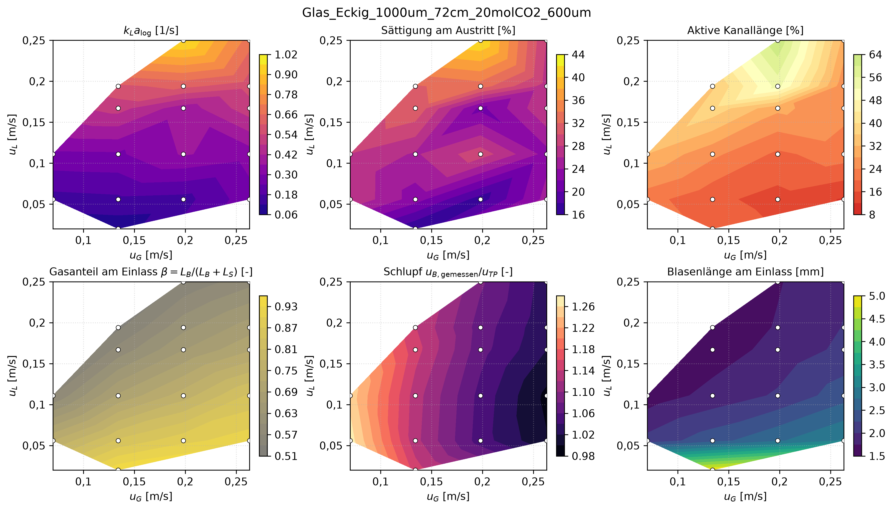

# 5 Plots

Alle Plots werden von `auswertung.py` nach `config.PLOTS` erzeugt und landen in
`ergebnisse/<Kanal>/plots/`. Sprache, Format, Größe und Auflösung stehen in
`config.STIL` ([Kapitel 3.5](03_konfiguration.md)). Mit `NEU_RECHNEN = False`
werden nur die Plots aus vorhandenen Ergebnissen neu gezeichnet; das dauert
Sekunden.

Jede Plotfunktion lässt sich auch direkt aus Python aufrufen
(Abschnitt 5.4), z. B. für Abbildungen in eigenen Arbeiten.

## 5.1 Je Betriebspunkt

### Blasenlängen-Fit (`blasenlaengen_fit`)



- **Punkte:** gemessene Blasenlängen, farbig je Kamera. Die grauen Bänder
  zeigen die Kamerafenster.
- **Hellblau gestrichelt:** Fit des Modells v2 ohne Offsets. Das ist die
  Kurve, mit der weitergerechnet wird.
- **Dunkelblau:** derselbe Fit plus Offset der jeweiligen Kamera; zwischen
  den Fenstern gepunktet überblendet. Diese Kurve muss den Punkten folgen.
- **Grün:** Blasenlänge auf den Einlassdruck umgerechnet (geglättet). Sie
  enthält nur noch die Absorption und muss deshalb monoton fallen und
  abflachen. Ein Wiederanstieg weist auf ein zu niedriges Druckprofil hin.
- **Kasten:** Kamera-Offsets, R² und χ²_red.

Worauf achten:
- Die Offsets sollten wenige µm betragen. Bei Werten im Bereich der
  Absorptionsamplitude A erscheint eine Warnung im Protokoll.
- χ²_red über etwa 3 bedeutet, dass das Modell die Streuung nicht erklärt.
- Einzelne Ausreißer (wie im Beispiel bei z ≈ 12 cm und 26 cm) dämpft der
  robuste Fit.

### Absorbierte Stoffmenge (`stoffmenge`)



Kumuliert absorbierte CO2-Menge je Blase in µmol über z. Der Verlauf flacht
ab, sobald die Flüssigkeit gesättigt ist oder das Gas verbraucht ist.

### Druckprofil (`druckprofil`)



Berechneter Absolutdruck, rückwärts vom gemessenen Auslassdruck integriert.
Die Steigung ist der Druckgradient des Bretherton- bzw. Kurimoto-Modells.

## 5.2 Je Kanal

### kLa-Fläche (`kla_flaeche`)



- **Inhalt:** kLa_log_mean über u_G und u_L. Die Fläche ist kubisch
  zwischen den Messpunkten interpoliert; Höhenlinien am Boden.
- **Nicht enthalten:** Betriebspunkte ohne gültigen kLa-Wert
  (`kla_ungueltig`, zu wenige Punkte).
- **Grenzen der Fläche:** Außerhalb der konvexen Hülle der Messpunkte
  bleibt sie leer. Bei wenigen, unregelmäßig verteilten Punkten kann die
  kubische Interpolation über- oder unterschwingen. Die Messpunkte selbst
  sind maßgeblich.

### Volumenspezifischer Molenstrom (`nspez_flaeche`)



ṅ_spez [mol/(s·m³)]: absorbierter CO2-Molenstrom bezogen auf das gesamte
Kanalvolumen (Definition in [6.8](06_methodik.md)). Als Bezug dient der ganze
Kanal, damit der Wert mit dem Monolithen vergleichbar bleibt. Deshalb zählen
auch die gesättigten Abschnitte mit.

### Modellfläche (`modell_flaechen`)



Vorhersage eines Literatur- oder eigenen Modells für dieselben
Betriebspunkte. Mögliche Namen sind `van_baten_voll`, `van_baten_kappe`,
`van_baten_film`, `vandu`, `shao`, `liu_wang`, `heiszwolf`, `yao`,
`yue_2007` und `yue_2009` sowie alle eigenen Modelle aus
`config/eigene_modelle.yaml`. Modelle, die für die Kanalform nicht definiert
sind (Yue nur eckig, Liu-Wang nur rund), werden mit einem Hinweis
übersprungen.

### Kennzahlen-Übersicht (`heatmaps`)



Sechs Größen als Farbkarten über u_G × u_L; die weißen Punkte sind die
Betriebspunkte.

| Feld | Größe |
|---|---|
| oben links | kLa_log_mean |
| oben Mitte | Sättigung C_L/C* am Kanalende |
| oben rechts | Anteil der Gitterpunkte mit lokalem kLa > 0 (Länge der aktiven Zone) |
| unten links | Gasanteil der Einheitszelle am Einlass β = L_B/(L_B + L_S) |
| unten Mitte | Schlupf: gemessene Blasengeschwindigkeit / (u_G + u_L) |
| unten rechts | gefittete Blasenlänge am Einlass |

Die Übersicht eignet sich, um eine neue Messreihe schnell auf Ausreißer zu
prüfen.

## 5.3 Weitere Plots

- **Paritätsdiagramme:** Messwerte gegen Literatur- und eigene Modelle,
  erzeugt von `literaturvergleich.py` ([Kapitel 8](08_literaturvergleich.md)).
- **Monolith:** 3D-Flächen und Parität, erzeugt von `monolith.py`
  ([Kapitel 10](10_monolith.md)).
- **Bretherton-Faktor c:** Fläche über u_G × u_L, erzeugt von
  `kalibrierung.py` ([Kapitel 9](09_druckkalibrierung.md)).

## 5.4 Plots direkt aus Python

```python
import config
from taylorflow import ergebnisse, plots

ordner = config.ERGEBNIS_ORDNER
kanal = "Glas_Eckig_1000um_72cm_20molCO2_600um"
bp = ergebnisse.lade_betriebspunkte(ordner, kanal)
profile = ergebnisse.lade_profile(ordner, kanal)

# Stil für eine Abbildung in einer Arbeit: englisch, PDF, ohne Titel, schmal
stil = plots.PlotStil(sprache="en", formate=("pdf",), titel_anzeigen=False,
                      groesse_3d_cm=(9, 7.5), schriftgroesse=8)

fig = plots.kla_flaeche(bp, stil)
plots.speichere(fig, "abbildungen", "kla_glas", stil)

profil = ergebnisse.profil_eines_betriebspunkts(profile, "Gas_0_134_Liq_0_056")
zeile = bp[bp["Config"] == "Gas_0_134_Liq_0_056"].iloc[0]
fig = plots.blasenlaengen_fit(profil, zeile, stil)
fig.axes[0].set_xlim(0, 40)          # die Figure lässt sich vor dem Speichern anpassen
plots.speichere(fig, "abbildungen", "blasen_glas", stil)
```

Für Vergleiche mehrerer 3D-Flächen auf gleichen Achsen nehmen `kla_flaeche`,
`nspez_flaeche`, `modell_flaeche` und `flaeche_3d` den Parameter
`achsen={"x": (0, 0.3), "y": (0, 0.3), "z": (0, 1.5)}`.
