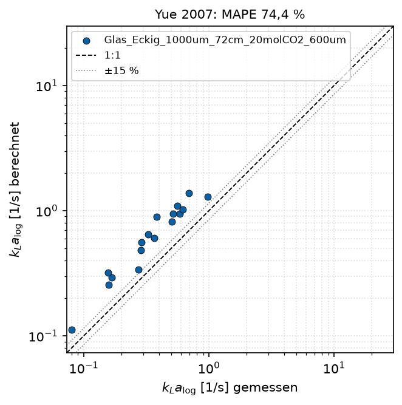
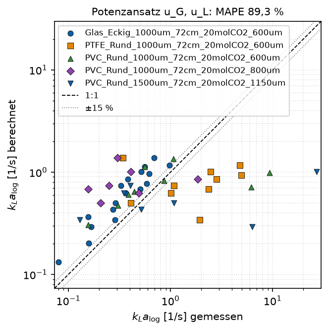

# 9 Literaturvergleich und eigene Modelle

`python literaturvergleich.py` vergleicht eine gemessene Kenngröße mit
Literaturmodellen und passt auf Wunsch ein eigenes Modell an.

## 9.1 Ablauf

1. `auswertung.py` muss für die gewünschten Kanäle gelaufen sein.
2. In `config.py`, Abschnitt `VERGLEICH`, festlegen:

   | Eintrag | Standard | Bedeutung |
   |---|---|---|
   | `kanaele` | `None` | `None` = alle Kanäle mit Ergebnissen; sonst Liste von Kanalnamen |
   | `zielgroesse` | `"kLa_log_mean_1_s"` | beliebige Zahlenspalte der Betriebspunkt-Tabelle |
   | `groesse_beschriftung` | `r"$k_La_{\mathrm{log}}$ [1/s]"` | Achsenbeschriftung der Zielgröße |
   | `modelle` | alle Literaturmodelle | Liste der Modelle für Tabelle und Paritätsdiagramme |
   | `band_prozent` | 15 | Breite des Bands ± um die Diagonale [%] |
   | `logarithmisch` | `True` | logarithmische Achsen |
   | `eigener_fit` | Block | eigenes Modell anpassen (9.3); `None` = kein Fit |

3. Ausführen. Ausgaben in `ergebnisse/vergleich/`:
   - `vergleich_<Zielgröße>.csv`: Statistik je Modell, sortiert nach MAPE
   - `paritaet_<Modell>.png`: Paritätsdiagramm je Modell, Kanäle farbig
   - `eigenes_modell_<Name>.png`: Parität des angepassten eigenen Modells

{width=65%}

**Paritätsdiagramm:** gemessene gegen berechnete Werte, Kanäle mit eigener
Farbe und Form. Die gestrichelte Diagonale ist die perfekte Übereinstimmung,
die gepunkteten Linien begrenzen die Abweichung ±`band_prozent`. Der Titel
nennt den MAPE. Kanäle, für die das Modell nicht gilt (hier die runden
Kanäle bei Yue 2007), fehlen. Größe und Sprache folgen `STIL`
(`groesse_paritaet_cm`, `sprache`, Kapitel 4.10).

Betriebspunkte mit `manual_exclude = True` werden nicht verwendet.

**Statistik in `vergleich_<Zielgröße>.csv`:**

| Spalte | Bedeutung |
|---|---|
| `n` | Anzahl Punkte mit gültigem Mess- und Modellwert |
| `MAPE_%` | mittlere absolute relative Abweichung |
| `Bias_%` | Median der relativen Abweichung; positiv = Modell zu hoch |
| `RMSE` | Wurzel der mittleren quadratischen Abweichung (Einheit der Zielgröße) |
| `im_Band_%` | Anteil der Punkte innerhalb ±`band_prozent` |

## 9.2 Literaturmodelle

Alle Modelle stehen in `taylorflow/literatur.py` mit Formel und
Originalbereich. Ihre Vorhersagen sind außerdem als Spalten
`kLa_lit_*_1_s` in jeder Betriebspunkt-Tabelle enthalten.

| Name | Quelle | Kanal | Formel (Kurzform) | Original |
|---|---|---|---|---|
| `van_baten_voll` | van Baten, Krishna 2004 | beide | Kappe + Film, Penetrationstheorie | rund, d 1,5–3 mm, L_UC 15–50 mm |
| `van_baten_kappe`, `van_baten_film` | dto. | beide | Anteile von Kappe bzw. Film | |
| `vandu` | Vandu et al. 2005 | beide | 4,5 √(D u_B / L_UC) / d | d 1–3 mm |
| `shao` | Shao et al. 2010 | beide | 3,0 √(D u_B / L_UC) / d | CFD, CO2/NaOH |
| `liu_wang` | Liu, Wang 2011 | rund | 0,12 Li^0,44 Pe^0,54 D/d² | d 1–3 mm, L_S 8–28 mm |
| `heiszwolf` | Heiszwolf et al. 2001 | beide | 0,133 u^1,2 / √L_S · (D/D_ref)^0,5 | Monolith, quadratisch |
| `yao` | Yao et al. 2023 | beide | van Baten mit Ca-Exponenten | 0,3 × 0,6 mm |
| `yue_2007` | Yue et al. 2007 | eckig | 0,084 Re_G^0,213 Re_L^0,937 Sc^0,5 D/d² | 0,5 × 1 mm, CO2/Wasser |
| `yue_2009` | Yue et al. 2009 | eckig | (2/d) √(D u_B/d) (L_B/L_UC)^0,3 | d 0,2–0,4 mm |

**Eingangsgrößen:**

- gemittelte gefittete Blasengeschwindigkeit u_B, Blasen- und Sluglänge
  sowie d und D(T) des Betriebspunkts
- Yue 2007 nutzt die Leerrohrgeschwindigkeiten
- Stoffwerte für Ca, Re und Sc sind fest (Wasser/CO2, ca. 25 °C)

Die mitgelieferten Kanäle liegen bei fast allen Modellen außerhalb des
Originalbereichs (größere Kanäle, längere Einheitszellen); die Abweichungen
sind entsprechend groß. Nur Yue 2007 folgt im Glaskanal dem Trend
(Steigung im log-log-Diagramm 0,92, R² = 0,92), mit rund 70 % systematischer
Überschätzung.

## 9.3 Eigenes Modell anpassen

Der Block `eigener_fit` in `config.VERGLEICH` passt einen Potenzansatz an:

$$y = a \cdot x_1^{b_1} \cdot x_2^{b_2} \cdots$$

- y ist die Zielgröße.
- x_k sind beliebige Zahlenspalten der Betriebspunkt-Tabelle, z. B.
  `GasVelocity_m_s`, `LiquidVelocity_m_s`, `BubbleLength_mean_m`,
  `SlugLength_mean_m`, `Velocity_mean_m_s`, `d_h_m`.
- Angepasst wird mit kleinsten Quadraten auf log y. Das minimiert relative
  Abweichungen.
- Ausgegeben werden die Formel, n, MAPE und R² im logarithmischen Raum.

```python
VERGLEICH = dict(
    ...
    eigener_fit=dict(
        name="pvc_kla",                    # Name zum späteren Aufruf
        titel="PVC: kLa = a uG^b uL^c",
        kanaele=["PVC_Rund_1000um_72cm_20molCO2_600um",
                 "PVC_Rund_1000um_72cm_20molCO2_800um"],
        variablen=["GasVelocity_m_s", "LiquidVelocity_m_s"],
        speichern=True,
    ),
)
```

{width=65%}

Mit `speichern=True` wird das Modell in `config/eigene_modelle.yaml`
abgelegt; ein gleichnamiger Eintrag wird überschrieben. Danach steht es
unter seinem Namen überall wie ein Literaturmodell zur Verfügung:

- in `VERGLEICH["modelle"]`
- im Plot `modell_flaechen` (Kapitel 4.7)
- in `MONOLITH["vergleich_modell"]` (Kapitel 11)

Aufbau eines gespeicherten Eintrags (Zahlenwerte nur zur Veranschaulichung):

```yaml
pvc_kla:
  titel: 'PVC: kLa = a uG^b uL^c'
  zielgroesse: kLa_log_mean_1_s
  variablen: [GasVelocity_m_s, LiquidVelocity_m_s]
  koeffizient: 12.3
  exponenten: [0.61, 0.95]
  form: potenz
  datengrundlage: [PVC_Rund_1000um_72cm_20molCO2_600um, PVC_Rund_1000um_72cm_20molCO2_800um]
  n_punkte: 16
  mape_prozent: 24.1
  r2_log: 0.81
  erstellt: '2026-10-14'
```

Die Datei darf auch von Hand bearbeitet werden, z. B. um eine
Literaturkorrelation in Potenzform mit eigenen Koeffizienten einzutragen.

**Andere Zielgrößen:** Jede Zahlenspalte ist möglich, z. B. `n_spez_mol_s_m3`
oder `slip_meas_over_theo`. Die Literaturmodelle beziehen sich alle auf kLa;
für andere Größen sind nur eigene Modelle sinnvoll.

## 9.4 Aus Python

```python
import config
from taylorflow import plots
from taylorflow.modellvergleich import (lade_betriebspunkte_mehrerer_kanaele, fit_potenzansatz,
                                        vergleichstabelle, vorhersage)

daten = lade_betriebspunkte_mehrerer_kanaele(config.ERGEBNIS_ORDNER)
glas = daten[daten["Kanal"].str.startswith("Glas")]

# Anderer Ansatz: kLa über Blasengeschwindigkeit und Einheitszellenlänge
glas = glas.assign(L_UC_m=glas["BubbleLength_mean_m"] + glas["SlugLength_mean_m"])
m = fit_potenzansatz(glas, "kLa_log_mean_1_s", ["Velocity_mean_m_s", "L_UC_m"], name="glas_ub_luc")
print(m.formel(), m.mape_prozent)

print(vergleichstabelle(glas, "kLa_log_mean_1_s", ["yue_2007", "vandu"]))

fig = plots.paritaet(glas["kLa_log_mean_1_s"], {"Yue 2007": vorhersage(glas, "yue_2007")},
                     plots.PlotStil(), r"$k_La$ [1/s]", band_prozent=30, logarithmisch=True)
plots.speichere(fig, "abbildungen", "paritaet_yue", plots.PlotStil())
```

Ein Modell, das abgeleitete Spalten wie hier `L_UC_m` nutzt, braucht diese
Spalte auch beim späteren Aufruf. Für die dauerhafte Nutzung über `config.py`
sind daher die vorhandenen Spalten der Betriebspunkt-Tabelle vorzuziehen.

## 9.5 Neues Literaturmodell als Formel ergänzen

Für Modelle, die kein Potenzansatz sind, wird in `taylorflow/literatur.py`
eine Funktion geschrieben und in `LITERATURMODELLE` eingetragen (Kapitel
12.3). Danach erscheint das Modell automatisch als Spalte in den
Betriebspunkt-Tabellen (nach erneuter Auswertung), im Vergleich und als
Fläche.
