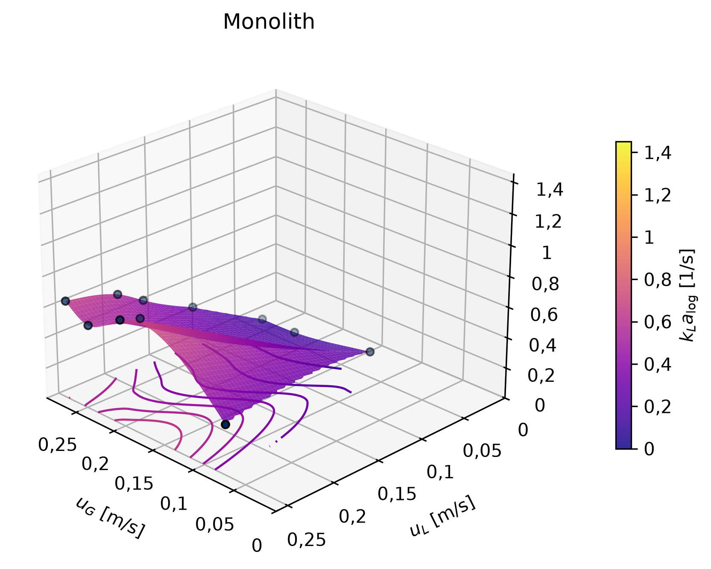
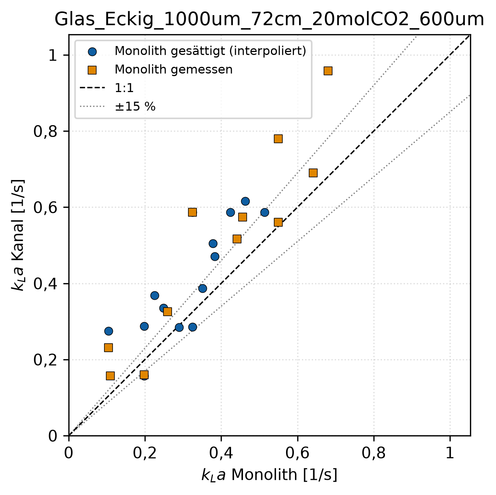

# 10 Monolith

`python monolith.py` wertet die Monolith-Messungen über eine Gasbilanz aus
und vergleicht sie mit einem Einzelkanal.

## 10.1 Messdaten

Die Datei `data/raw/Monolith_Messungen.csv` enthält eine Zeile je
Betriebspunkt, Semikolon-getrennt und mit Dezimalpunkt:

| Spalte | Einheit | Bedeutung |
|---|---|---|
| `V_L_L_h` | L/h | Flüssigkeitsvolumenstrom |
| `V_G_in_L_h`, `V_G_out_L_h` | L/h | Gasvolumenstrom am Ein- und Austritt |
| `y_CO2_in`, `y_CO2_out` | % | CO2-Anteil am Ein- und Austritt (Analysator) |
| `T_in_C`, `T_out_C` | °C | Temperatur |
| `p_in_Pa`, `p_out_Pa` | Pa | Absolutdruck |

Die Geometrie steht in `config.MONOLITH`:
- `n_kanaele` (Standard 100)
- `d_kanal_m`: Seitenlänge der quadratischen Kanäle, Standard 1 mm
- `laenge_m`: Standard 1 m

## 10.2 Rechnung

Alle Kanäle werden gemeinsam betrachtet. Gesamtquerschnitt $A = N d^2$,
Volumen $V = A\,L$.

**Leerrohrgeschwindigkeiten:**

$$u_G = \dot V_{G,ein}/A, \qquad u_L = \dot V_L / A$$

**Absorbierter Molenstrom** aus der Gasbilanz, mit $c_G = p\,y/(RT)$:

$$\dot n = \dot V_{G,ein}\, c_{G,ein} - \dot V_{G,aus}\, c_{G,aus}, \qquad
\dot n_{spez} = \dot n / V$$

**Gleichgewicht, Verweilzeit und Austrittskonzentration:**

$$C^* = H(T)\,p\,y, \qquad t = L/u_L, \qquad C_{L,aus} = \dot n\, t / (\dot V_L t)$$

**kLa** mit logarithmischer Konzentrationsdifferenz
($\Delta C_{ein} = C^*_{ein}$, $\Delta C_{aus} = C^*_{aus} - C_{L,aus}$):

$$k_La = \frac{\dot n}{V_L\,\Delta C_{log}}, \qquad
\Delta C_{log} = \frac{\Delta C_{ein} - \Delta C_{aus}}{\ln(\Delta C_{ein}/\Delta C_{aus})}$$

Die Henry-Konstante folgt van't Hoff mit eigenen Parametern
(`henry_ref_mol_m3_pa = 3,3·10⁻⁴`, `henry_dlnh_dt_k = 2400`). Diese Werte
entsprechen der Auswertung des Monolithen im Praktikum und weichen leicht
von denen der Kanalauswertung ab (3,36·10⁻⁴).

**Gesättigte Betriebspunkte:** Ist ΔC_aus ≤ 0, ist die Flüssigkeit am
Austritt gesättigt, und kLa ist nicht bestimmbar (leer). In den
mitgelieferten Daten betrifft das 14 von 25 Betriebspunkten.

## 10.3 Ausgaben

In `ergebnisse/monolith/`:

| Datei | Inhalt |
|---|---|
| `monolith_kennwerte.csv` | u_G, u_L, kLa, ṅ_spez, Sättigungskennung je Betriebspunkt |
| `kla_monolith.png`, `nspez_monolith.png` | 3D-Flächen des Monolithen |
| `kla_kanal.png`, `nspez_kanal.png` | dieselben Größen für `vergleich_kanal` |
| `kla_modell.png` | Modellfläche (`vergleich_modell`, z. B. Yue 2007) |
| `paritaet_monolith_kanal.png` | Parität kLa Kanal gegen kLa Monolith |

Alle 3D-Flächen eines Laufs haben dieselben Achsbereiche und sind direkt
vergleichbar.

**Paritätsdiagramm:**
- Die Kanalwerte werden auf die Betriebspunkte des Monolithen interpoliert.
- Für gesättigte Monolith-Punkte wird der Monolith-Wert aus der eigenen
  Fläche interpoliert und gesondert markiert.

## 10.4 Einordnung

ṅ_spez des Kanals ist absichtlich auf das gesamte Kanalvolumen bezogen, wie
beim Monolithen ([6.8](06_methodik.md)). kLa des Kanals ist dagegen das
Log-Mean über die aktive Zone ([6.7](06_methodik.md)), kLa des Monolithen ein
Log-Mean über den ganzen Reaktor. Bei frühzeitiger Sättigung sind die beiden
kLa-Werte deshalb nur eingeschränkt vergleichbar.
