# 4 Selecting and adjusting plots

## 4.1 Principle

After the calculation, `auswertung.py` creates all plots that are switched
on and saves them in `ergebnisse/<channel>/plots/`. What appears and how it
looks is set in two places in `config.py`:

| Section | Applies to | Examples |
|---|---|---|
| `PLOTS` | one block per plot | on/off, axis ranges, plot elements, colours, colour map, heat map fields |
| `STIL` (style) | all plots together | language, file format, resolution, font size, default sizes, titles on/off |

Each block in `PLOTS` lists **all** possible entries with their default
value. To adjust a plot, only the value is changed:

```python
PLOTS = dict(
    blasenlaengen_fit=dict(
        an=True, titel="auto", groesse_cm=None,
        x_bereich_cm=None,              # reactor position z [cm]
        y_bereich_mm=None,              # bubble length [mm]
        ...
```

After a change, a run with `NEU_RECHNEN = False` is sufficient (chapter
3.5); the plots are then redrawn within seconds.

**Common to all plots:**

| Entry | Meaning | Example |
|---|---|---|
| `an` (on) | create the plot | `an=False` |
| `titel` (title) | `"auto"` = channel name (or channel and operating point), own text, or `""` for no title | `titel="PVC, 1 mm"` |
| `groesse_cm` (size) | (width, height) in cm; `None` = default size from `STIL` | `groesse_cm=(9, 7)` |
| axis ranges (`…_bereich…`) | `(min, max)` in the unit of the axis; `None` = automatic | `x_bereich_cm=(0, 40)` |
| colours (`farbe`) | name (`"tab:red"`, `"black"`) or hex code (`"#3B8B3B"`) | `farbe="tab:red"` |
| colour maps (`farbskala`) | name of a matplotlib colour map | `farbskala="viridis"` |

Common colour maps: `"plasma"`, `"viridis"`, `"cividis"`, `"magma"`,
`"coolwarm"`, `"RdYlGn"`, `"Blues"`. The suffix `_r` reverses a map
(`"viridis_r"`).

**Typing errors** are reported immediately, with all possible names:

```
KeyError: "Unbekannte Option ['farbskale'] für den Plot 'kla_flaeche'.
Möglich: ['achsen', 'an', 'blickwinkel', 'farbskala', 'groesse_cm', ...]"
```

**Overview of the plots**

| Block in `PLOTS` | Plot | File | Section |
|---|---|---|---|
| `blasenlaengen_fit` | bubble length along the channel with fit | `blasenlaenge_<operating point>.png` | 4.2 |
| `stoffmenge` | absorbed amount of CO2 per bubble | `stoffmenge_<operating point>.png` | 4.3 |
| `druckprofil` | calculated pressure along the channel | `druck_<operating point>.png` | 4.4 |
| `kla_flaeche` | kLa_log_mean over u_G and u_L (3D) | `kla_flaeche.png` | 4.5 |
| `nspez_flaeche` | volume-specific molar flux (3D) | `nspez_flaeche.png` | 4.6 |
| `modell_flaechen` | prediction of literature or own models (3D) | `modell_<model>.png` | 4.7 |
| `spalten_flaechen` | any column of the result table (3D), off by default | `flaeche_<column>.png` | 4.8 |
| `heatmaps` | overview of key figures as colour maps | `heatmaps.png` | 4.9 |

The first three plots are created **per operating point**; which operating
points is set by `BETRIEBSPUNKTE` (chapter 3.5). The others are created
**per channel**.

## 4.2 Bubble length fit (`blasenlaengen_fit`)

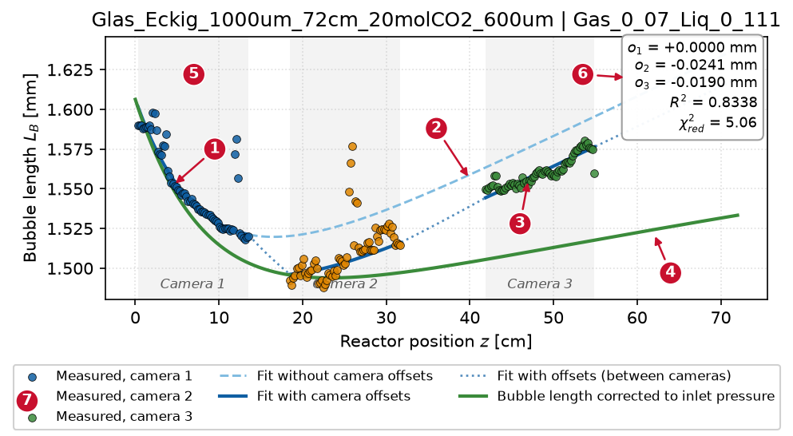

| No. | Plot element | Meaning | Entry |
|---|---|---|---|
| 1 | dots, coloured per camera | measured bubble lengths per bin | `messwerte` |
| 2 | light blue, dashed | fit **without** camera offsets; this curve is used for the calculation | `fit_ohne_offsets` |
| 3 | dark blue, dotted between the cameras | the same fit plus the offset of each camera; must follow the dots | `fit_mit_offsets` |
| 4 | green | bubble length converted to the inlet pressure; contains only the absorption | `druckkorrigiert` |
| 5 | grey bands | range of the data points per camera | `kamerafenster` |
| 6 | box | camera offsets o_j, R² and χ²_red of the fit | `kennwertkasten` |
| 7 | legend | explanation of the lines | `legende` |

**What to look for:**

- The dark blue curve follows the dots of all cameras.
- The green curve decreases and levels off. A rise indicates a pressure
  profile that is calculated too low.
- The offsets are a few hundredths of a millimetre. If an offset is of the
  size of the absorption, the warning log reports it.
- χ²_red above about 3 means that the model does not fully explain the
  scatter. Single outliers (in the figure at z ≈ 12 cm and 26 cm) are
  damped by the robust fit.

**Adjusting**

| Wish | Entry in block `blasenlaengen_fit` |
|---|---|
| show only the front part of the channel | `x_bereich_cm=(0, 40)` |
| fixed y axis for several operating points | `y_bereich_mm=(1.4, 1.7)` |
| without the dashed fit | `fit_ohne_offsets=False` |
| data and fit only, without pressure correction | `druckkorrigiert=False` |
| without grey camera bands | `kamerafenster=False` |
| without the box of key figures | `kennwertkasten=False` |
| legend inside the plot instead of below | `legende="innen"` (free spot) or e.g. `legende="upper right"` |
| no legend | `legende="aus"` |

Possible legend positions: `"upper left"`, `"upper center"`,
`"upper right"`, `"center left"`, `"center"`, `"center right"`,
`"lower left"`, `"lower center"`, `"lower right"`.

Example: left the default, right with
`x_bereich_cm=(0, 40), fit_ohne_offsets=False, kennwertkasten=False, legende="upper right"`.

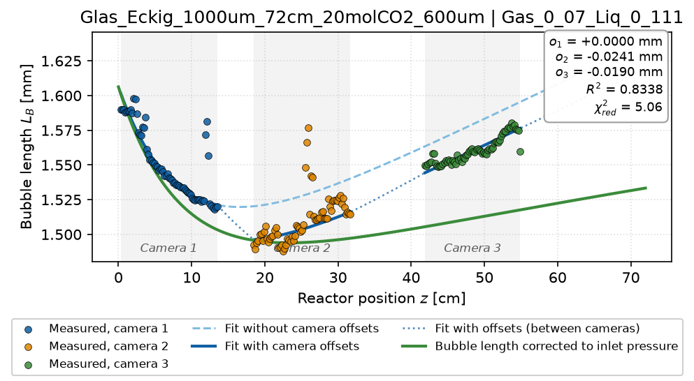{width=49%} 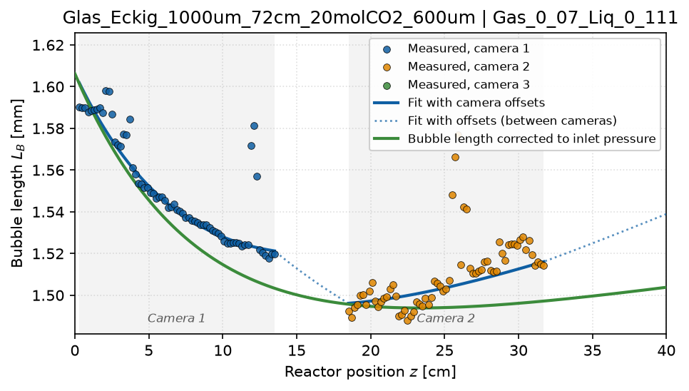{width=49%}

## 4.3 Absorbed amount (`stoffmenge`)

Cumulative absorbed amount of CO2 per bubble in µmol over the channel
position. The curve levels off as soon as the liquid is saturated or the
CO2 is used up.

| Wish | Entry in block `stoffmenge` |
|---|---|
| axis ranges | `x_bereich_cm=(0, 30)`, `y_bereich_umol=(0, 0.5)` |
| no filled area below the curve | `flaeche=False` |
| other line colour | `farbe="tab:red"` |

Left the default, right with
`flaeche=False, farbe="tab:red", x_bereich_cm=(0, 30)`:

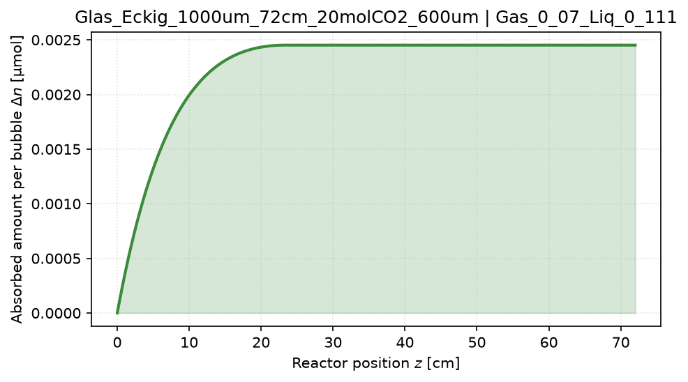{width=49%} 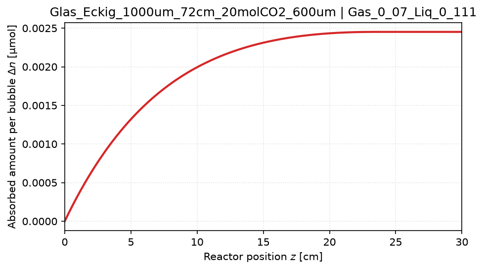{width=49%}

## 4.4 Pressure profile (`druckprofil`)

Calculated absolute pressure, integrated backwards from the measured outlet
pressure. The slope is the pressure gradient of the Bretherton or Kurimoto
model (chapter 7.4).

| Wish | Entry in block `druckprofil` |
|---|---|
| pressure in mbar, hPa, kPa or bar | `einheit="mbar"` |
| axis ranges (y in the chosen unit) | `x_bereich_cm=(0, 72)`, `y_bereich=(1000, 1100)` |
| other line colour | `farbe="black"` |

Left the default, right with `einheit="mbar", titel=""`:

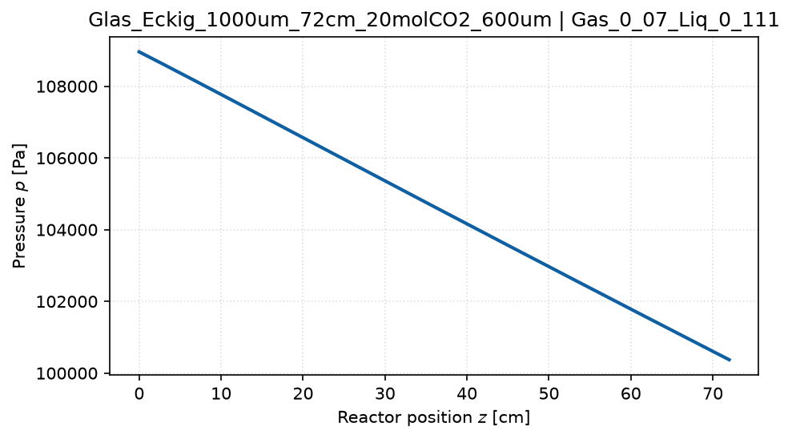{width=49%} 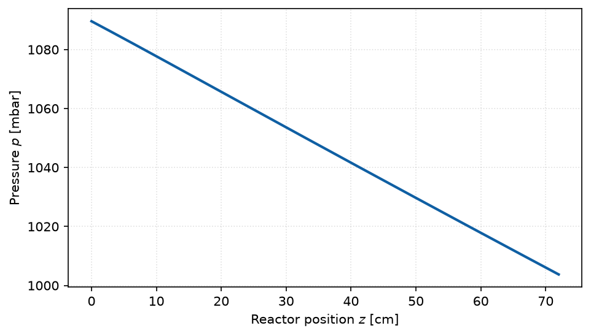{width=49%}

## 4.5 kLa surface (`kla_flaeche`)

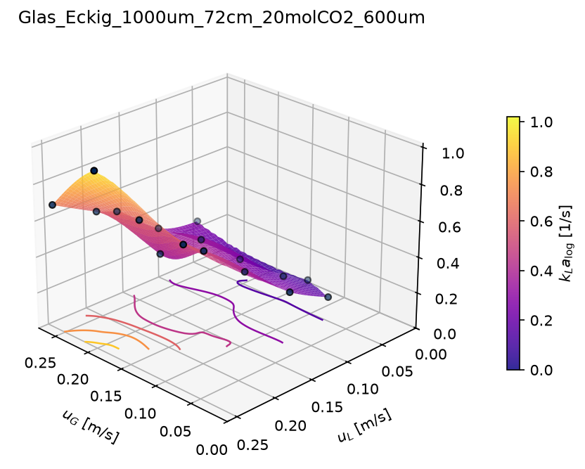{width=75%}

- **Surface:** kLa_log_mean over u_G and u_L, interpolated cubically between
  the data points; outside the data points it stays empty.
- **Dots:** the measured values. With few, irregularly spaced points the
  interpolation can over- or undershoot; the dots are what counts.
- **Lines at the bottom:** contour lines.
- Operating points without a valid kLa value (`kla_ungueltig`) are missing.

**Adjusting** (applies equally to all 3D surfaces, sections 4.6 to 4.8)

| Wish | Entry |
|---|---|
| other colour map | `farbskala="viridis"` |
| fixed axis ranges, e.g. for comparing several channels | `achsen=dict(x=(0, 0.3), y=(0, 0.3), z=(0, 1.5))`; axes not given remain automatic |
| other viewing direction | `blickwinkel=(35, 220)`: elevation and rotation in degrees |
| without data points | `messpunkte=False` |
| without contour lines | `hoehenlinien=False` |
| opaque or more transparent surface | `transparenz=1.0` or `0.5` |

Viewing direction: elevation 0° is the side view, 90° the top view; the
rotation turns the plot about the vertical axis (default `(25, 135)`).

Left the default, right with
`farbskala="viridis", blickwinkel=(35, 220), achsen=dict(z=(0, 1.5)), hoehenlinien=False`:

{width=49%} 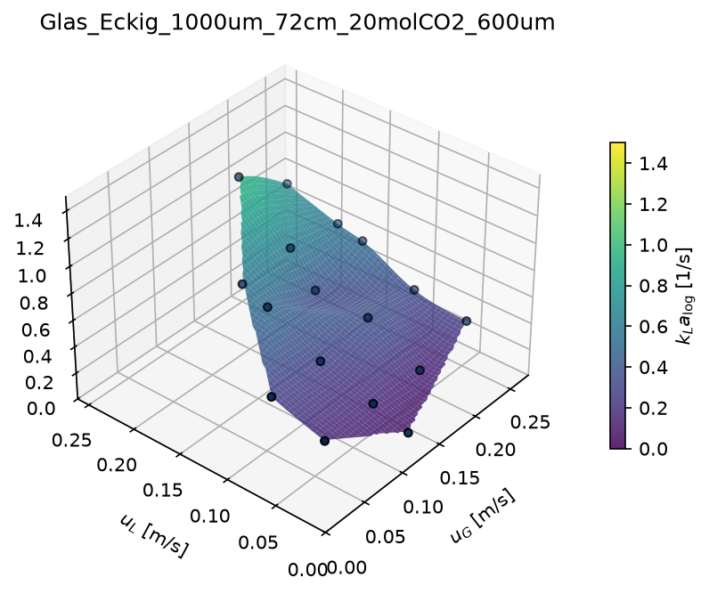{width=49%}

## 4.6 Volume-specific molar flux (`nspez_flaeche`)

ṅ_spec [mol/(s·m³)]: absorbed molar flux of CO2 related to the whole channel
volume (definition in chapter 7.7). Relating it to the whole channel makes
the value comparable with the monolith; saturated sections therefore count
as well. Options as in 4.5.

Left the default, right with
`farbskala="cividis", messpunkte=False, transparenz=1.0`:

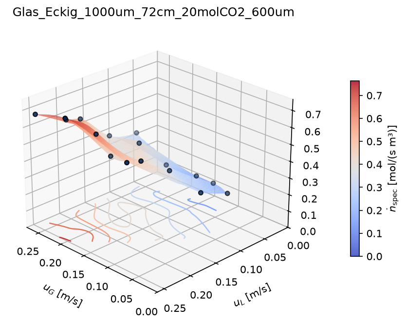{width=49%} 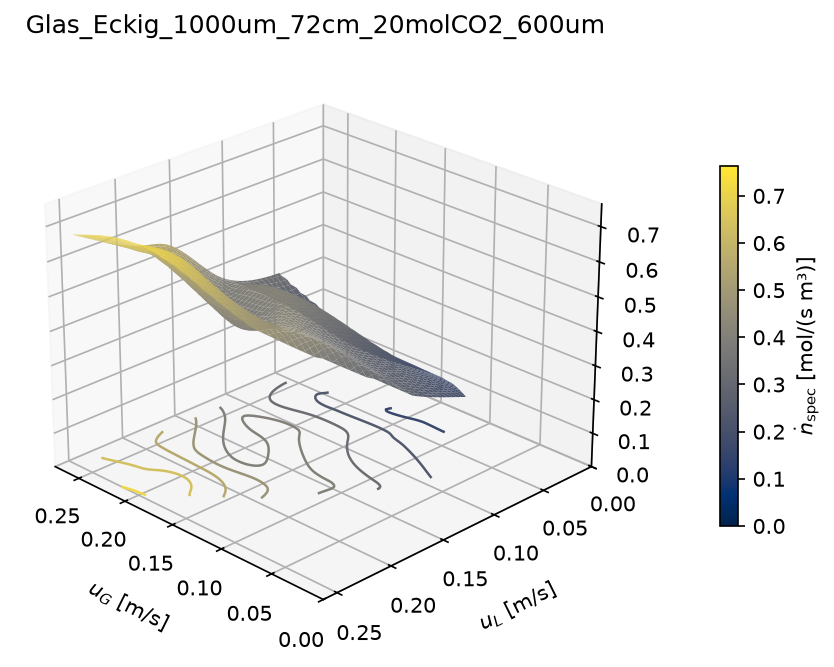{width=49%}

## 4.7 Model surfaces (`modell_flaechen`)

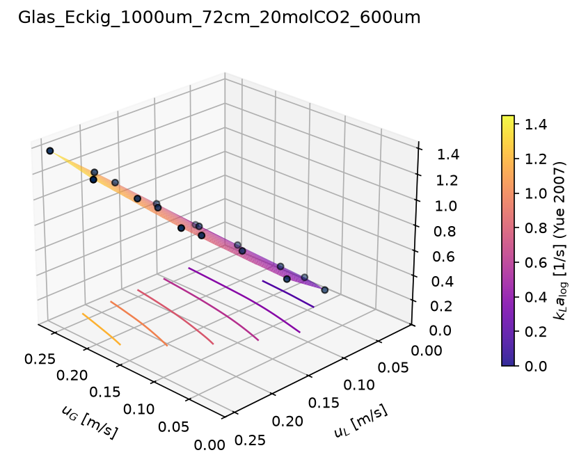{width=75%}

Prediction of a literature or own model for the same operating points, one
figure per model. The models are listed in `modelle`:

```python
modell_flaechen=dict(an=True, modelle=["yue_2007", "vandu"], ...)
```

Possible names: `van_baten_voll`, `van_baten_kappe`, `van_baten_film`,
`vandu`, `shao`, `liu_wang`, `heiszwolf`, `yao`, `yue_2007`, `yue_2009` and
all own models from `config/eigene_modelle.yaml` (chapter 9). Models that do
not apply to the channel shape (Yue square only, Liu-Wang circular only) are
skipped with a note. Other options as in 4.5.

## 4.8 Any column as a surface (`spalten_flaechen`)

Every numeric column of the operating point table (chapter 6.2) can be
drawn as a 3D surface over u_G and u_L. The block is switched off by
default. Each entry in `spalten` creates one figure `flaeche_<column>.png`:

```python
spalten_flaechen=dict(
    an=True, ...,
    spalten=[
        dict(spalte="SlugLength_mean_m", beschriftung="Slug length $L_S$ [mm]", faktor=1000),
        dict(spalte="slip_meas_over_theo", beschriftung="Slip [-]"),
    ],
)
```

| Entry per column | Meaning |
|---|---|
| `spalte` (column) | column name as in the table |
| `beschriftung` (label) | text at the colour bar; without it the column name. Formulas in `$…$` |
| `faktor` (factor) | conversion before drawing, e.g. `1000` for m → mm |

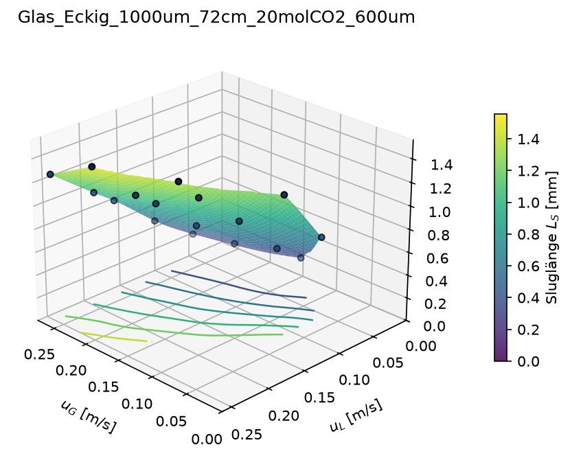{width=75%}

## 4.9 Overview of key figures (`heatmaps`)

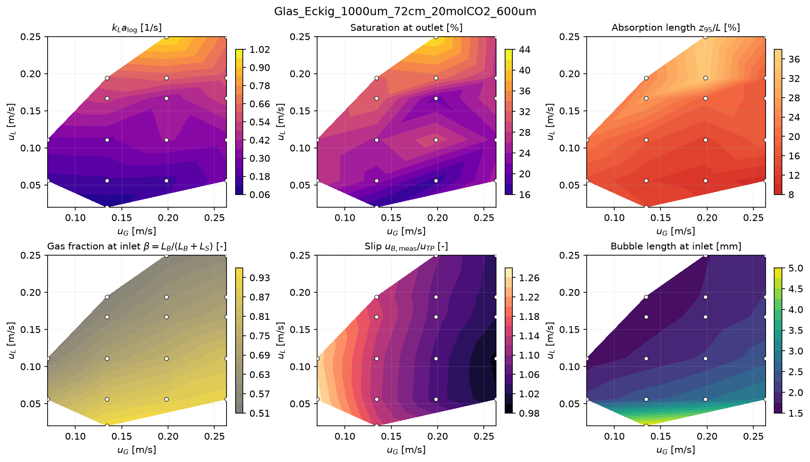

Several quantities as colour maps over u_G × u_L; the white dots are the
operating points. The overview is suited to checking a new series quickly
for outliers. Default fields in reading order:

| Name in `felder` | Quantity |
|---|---|
| `"kla"` | kLa_log_mean |
| `"saettigung_aus"` | saturation C_L/C* at the channel end |
| `"z95"` | absorption length: position at which 95 % of the total absorbed amount of CO2 has been taken up, relative to the channel length |
| `"beta_ein"` | gas fraction of the unit cell at the inlet, β = L_B/(L_B + L_S) |
| `"schlupf"` | measured bubble velocity / (u_G + u_L) |
| `"L_b_ein"` | fitted bubble length at the inlet |

**Adjusting**

| Wish | Entry in block `heatmaps` |
|---|---|
| other selection or order | `felder=["kla", "z95", "schlupf"]`; up to three fields per row |
| a column of the operating point table as a field | `felder=["kla", "n_spez_mol_s_m3"]` |
| heading of a field | `beschriftungen={"n_spez_mol_s_m3": "ṅ_spec [mol/(s m³)]"}` |
| colour map of a field | `farbskalen=dict(kla="viridis")` |

Example with three fields:
`felder=["kla", "z95", "n_spez_mol_s_m3"]`, own heading for
`n_spez_mol_s_m3` and `farbskalen=dict(kla="viridis")`:

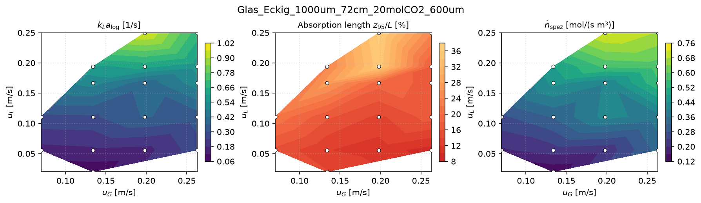

## 4.10 Appearance of all plots (`STIL`)

| Entry | Default | Meaning |
|---|---|---|
| `sprache` (language) | `"de"` | `"de"` (decimal comma) or `"en"` (decimal point, English labels) |
| `formate` (formats) | `("png",)` | one or more file formats, e.g. `("png", "pdf")`; PDF and SVG scale without loss |
| `dpi` | 300 | resolution of the PNG files |
| `schriftgroesse` (font size) | 10 | base font size in pt |
| `groesse_profil_cm` | (16, 9) | default size of the plots per operating point |
| `groesse_3d_cm` | (14, 11) | default size of the 3D surfaces |
| `groesse_heatmaps_cm` | (30, 17) | default size of the key figure overview (for 2 × 3 fields) |
| `groesse_paritaet_cm` | (12, 11) | parity plots (chapters 9 and 11) |
| `titel_anzeigen` (show titles) | `True` | `False` switches off all titles, e.g. for figures in a thesis |
| `blickwinkel_3d` | (25, 135) | default viewing direction of the 3D surfaces |

`STIL` also applies to `literaturvergleich.py`, `monolith.py` and
`kalibrierung.py`. A size in the block of a plot (`groesse_cm`) takes
precedence over the default size. All figures in this English manual were
created with `sprache="en"`.

Left with title (default), right with `titel_anzeigen=False`:

{width=49%} 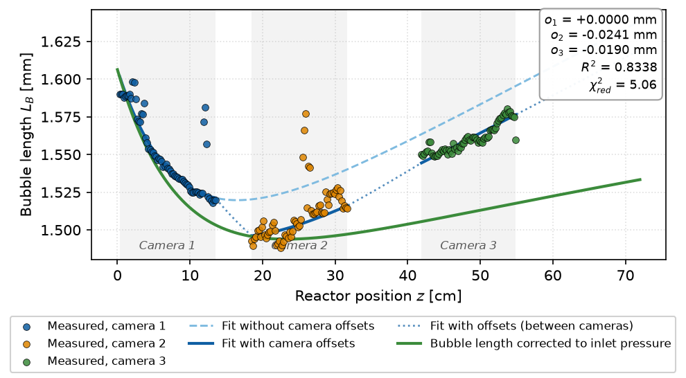{width=49%}

## 4.11 Creating a single figure (`abbildung.py`)

A figure for a thesis or a presentation often needs exactly one plot in a
particular form, without changing `config.py` permanently. This is what
`abbildung.py` is for. At the top of the file there are only a few settings:

```python
KANAL = "Glas_Eckig_1000um_72cm_20molCO2_600um"   # folder name in ergebnisse/
PLOT = "blasenlaengen_fit"                        # name of a block in config.PLOTS
BETRIEBSPUNKT = "Gas_0_134_Liq_0_056"             # only for plots per operating point

ANPASSUNGEN = dict(                               # changes compared with config.PLOTS[PLOT]
    x_bereich_cm=(0, 40),
    kennwertkasten=False,
    legende="upper right",
)
STIL_ANPASSUNGEN = dict(                          # changes compared with config.STIL
    sprache="en",
    formate=("png", "pdf"),
    titel_anzeigen=False,
)
ZIEL_ORDNER = config.ERGEBNIS_ORDNER / "abbildungen"   # target folder
DATEINAME = None        # file name; None = name as in auswertung.py
VORSCHAU = True         # also show the figure in a window
```

Then run `python abbildung.py`. The figure is saved and, with
`VORSCHAU = True`, shown in a window. In this window it can be zoomed and
moved; the saved version is the one with the settings from the file.

- Nothing is recalculated. `auswertung.py` must already have been run for
  the channel.
- `ANPASSUNGEN` accepts all entries of the respective block in
  `config.PLOTS` (sections 4.2 to 4.9).
- For `modell_flaechen` and `spalten_flaechen`, one figure is created per
  model or column.

## 4.12 Recipes

**Figure for a thesis (narrow, English, vector graphics).** In
`abbildung.py`:

```python
PLOT = "kla_flaeche"
ANPASSUNGEN = dict(groesse_cm=(8, 7), farbskala="viridis")
STIL_ANPASSUNGEN = dict(sprache="en", formate=("pdf",), titel_anzeigen=False, schriftgroesse=8)
```

**Comparing several channels on the same axes.** Set fixed axes for the
surface in `config.py`, then evaluate or redraw all channels:

```python
kla_flaeche=dict(..., achsen=dict(x=(0, 0.3), y=(0, 0.3), z=(0, 1.5)), ...)
```

**Only the overview plots, no plots per operating point.** In `config.py`,
set `an=False` in the blocks `blasenlaengen_fit`, `stoffmenge` and
`druckprofil`.

**Another quantity as a surface.** In `spalten_flaechen`, set `an=True` and
enter the column in `spalten` (4.8). Chapter 6.2 lists the available
columns.

**Key figure overview with an own selection.** `felder` in block
`heatmaps` (4.9).

## 4.13 Plots directly from Python

All plot functions can also be called directly. They return a matplotlib
figure that can be edited further before saving:

```python
import config
from taylorflow import ergebnisse, plots

ordner = config.ERGEBNIS_ORDNER
kanal = "Glas_Eckig_1000um_72cm_20molCO2_600um"
bp = ergebnisse.lade_betriebspunkte(ordner, kanal)
profile = ergebnisse.lade_profile(ordner, kanal)
stil = plots.PlotStil(**config.STIL).mit(sprache="en")

fig = plots.kla_flaeche(bp, stil, titel="", farbskala="viridis", achsen=dict(z=(0, 1.5)))
fig.axes[0].set_zlabel("kLa [1/s]")              # any matplotlib change
plots.speichere(fig, "abbildungen", "kla_glas", stil)

profil = ergebnisse.profil_eines_betriebspunkts(profile, "Gas_0_134_Liq_0_056")
zeile = bp[bp["Config"] == "Gas_0_134_Liq_0_056"].iloc[0]
fig = plots.blasenlaengen_fit(profil, zeile, stil, x_bereich_cm=(0, 40), legende="innen")
plots.speichere(fig, "abbildungen", "blasen_glas", stil)
```

The parameters of each function correspond to the entries of the blocks in
`config.PLOTS`; `help(plots.blasenlaengen_fit)` shows them.
