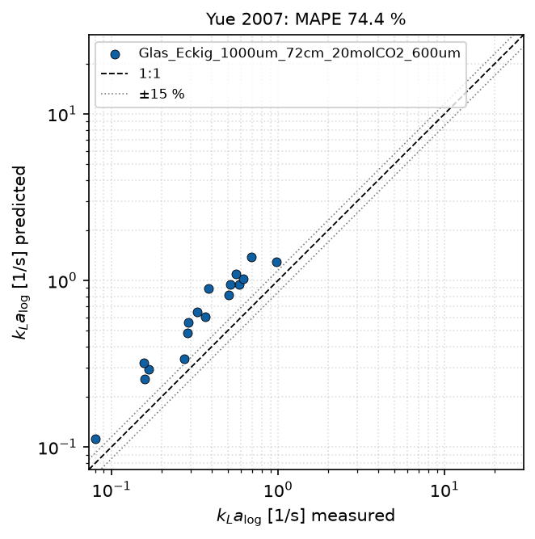
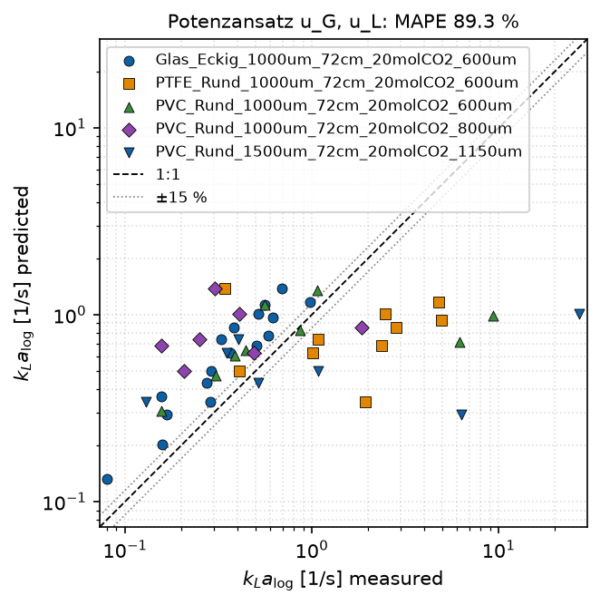

# 9 Literature comparison and own models

`python literaturvergleich.py` compares a measured quantity with literature
models and fits an own model if desired.

## 9.1 Procedure

1. `auswertung.py` must have been run for the desired channels.
2. In `config.py`, section `VERGLEICH`, set:

   | Entry | Default | Meaning |
   |---|---|---|
   | `kanaele` (channels) | `None` | `None` = all channels with results; otherwise a list of channel names |
   | `zielgroesse` (target quantity) | `"kLa_log_mean_1_s"` | any numeric column of the operating point table |
   | `groesse_beschriftung` (label) | `r"$k_La_{\mathrm{log}}$ [1/s]"` | axis label of the target quantity |
   | `modelle` (models) | all literature models | list of models for the table and the parity plots |
   | `band_prozent` (band) | 15 | width of the band ± around the diagonal [%] |
   | `logarithmisch` (logarithmic) | `True` | logarithmic axes |
   | `eigener_fit` (own fit) | block | fit an own model (9.3); `None` = no fit |

3. Run it. Outputs in `ergebnisse/vergleich/`:
   - `vergleich_<target>.csv`: statistics per model, sorted by MAPE
   - `paritaet_<model>.png`: parity plot per model, channels in colour
   - `eigenes_modell_<name>.png`: parity of the fitted own model

{width=65%}

**Parity plot:** measured against calculated values, channels with their
own colour and marker. The dashed diagonal is perfect agreement; the dotted
lines bound the deviation ±`band_prozent`. The title gives the MAPE.
Channels to which the model does not apply (here the circular channels for
Yue 2007) are missing. Size and language follow `STIL`
(`groesse_paritaet_cm`, `sprache`, chapter 4.10).

Operating points with `manual_exclude = True` are not used.

**Statistics in `vergleich_<target>.csv`:**

| Column | Meaning |
|---|---|
| `n` | number of points with a valid measured and model value |
| `MAPE_%` | mean absolute percentage error |
| `Bias_%` | median of the relative deviation; positive = model too high |
| `RMSE` | root mean square error (unit of the target quantity) |
| `im_Band_%` | fraction of points within ±`band_prozent` |

## 9.2 Literature models

All models are in `taylorflow/literatur.py` with formula and original range.
Their predictions are also included as columns `kLa_lit_*_1_s` in every
operating point table.

| Name | Source | Channel | Formula (short) | Original |
|---|---|---|---|---|
| `van_baten_voll` | van Baten, Krishna 2004 | both | cap + film, penetration theory | circular, d 1.5–3 mm, L_UC 15–50 mm |
| `van_baten_kappe`, `van_baten_film` | ditto | both | contribution of cap or film | |
| `vandu` | Vandu et al. 2005 | both | 4.5 √(D u_B / L_UC) / d | d 1–3 mm |
| `shao` | Shao et al. 2010 | both | 3.0 √(D u_B / L_UC) / d | CFD, CO2/NaOH |
| `liu_wang` | Liu, Wang 2011 | circular | 0.12 Li^0.44 Pe^0.54 D/d² | d 1–3 mm, L_S 8–28 mm |
| `heiszwolf` | Heiszwolf et al. 2001 | both | 0.133 u^1.2 / √L_S · (D/D_ref)^0.5 | monolith, square |
| `yao` | Yao et al. 2023 | both | van Baten with Ca exponents | 0.3 × 0.6 mm |
| `yue_2007` | Yue et al. 2007 | square | 0.084 Re_G^0.213 Re_L^0.937 Sc^0.5 D/d² | 0.5 × 1 mm, CO2/water |
| `yue_2009` | Yue et al. 2009 | square | (2/d) √(D u_B/d) (L_B/L_UC)^0.3 | d 0.2–0.4 mm |

**Inputs:**

- averaged fitted bubble velocity u_B, bubble and slug length as well as d
  and D(T) of the operating point
- Yue 2007 uses the superficial velocities
- property data for Ca, Re and Sc are fixed (water/CO2, approx. 25 °C)

The supplied channels lie outside the original range of almost all models
(larger channels, longer unit cells); the deviations are correspondingly
large. Only Yue 2007 follows the trend in the glass channel (slope in the
log-log plot 0.92, R² = 0.92), with about 70 % systematic overestimation.

## 9.3 Fitting an own model

The block `eigener_fit` in `config.VERGLEICH` fits a power law:

$$y = a \cdot x_1^{b_1} \cdot x_2^{b_2} \cdots$$

- y is the target quantity.
- x_k are any numeric columns of the operating point table, e.g.
  `GasVelocity_m_s`, `LiquidVelocity_m_s`, `BubbleLength_mean_m`,
  `SlugLength_mean_m`, `Velocity_mean_m_s`, `d_h_m`.
- The fit is a least-squares fit on log y. This minimises relative
  deviations.
- The output is the formula, n, MAPE and R² in logarithmic space.

```python
VERGLEICH = dict(
    ...
    eigener_fit=dict(
        name="pvc_kla",                    # name for later use
        titel="PVC: kLa = a uG^b uL^c",
        kanaele=["PVC_Rund_1000um_72cm_20molCO2_600um",
                 "PVC_Rund_1000um_72cm_20molCO2_800um"],
        variablen=["GasVelocity_m_s", "LiquidVelocity_m_s"],
        speichern=True,                    # save
    ),
)
```

{width=65%}

With `speichern=True` the model is saved in `config/eigene_modelle.yaml`; an
entry of the same name is overwritten. It is then available everywhere by
its name, like a literature model:

- in `VERGLEICH["modelle"]`
- in the plot `modell_flaechen` (chapter 4.7)
- in `MONOLITH["vergleich_modell"]` (chapter 11)

Structure of a saved entry (numbers for illustration only):

```yaml
pvc_kla:
  titel: 'PVC: kLa = a uG^b uL^c'
  zielgroesse: kLa_log_mean_1_s
  variablen: [GasVelocity_m_s, LiquidVelocity_m_s]
  koeffizient: 12.3
  exponenten: [0.61, 0.95]
  form: potenz
  datengrundlage: [PVC_Rund_1000um_72cm_20molCO2_600um, PVC_Rund_1000um_72cm_20molCO2_800um]
  n_punkte: 16
  mape_prozent: 24.1
  r2_log: 0.81
  erstellt: '2026-10-14'
```

The file may also be edited by hand, e.g. to enter a literature
correlation in power-law form with own coefficients.

**Other target quantities:** any numeric column is possible, e.g.
`n_spez_mol_s_m3` or `slip_meas_over_theo`. The literature models all refer
to kLa; for other quantities only own models make sense.

## 9.4 From Python

```python
import config
from taylorflow import plots
from taylorflow.modellvergleich import (lade_betriebspunkte_mehrerer_kanaele, fit_potenzansatz,
                                        vergleichstabelle, vorhersage)

daten = lade_betriebspunkte_mehrerer_kanaele(config.ERGEBNIS_ORDNER)
glas = daten[daten["Kanal"].str.startswith("Glas")]

# Another approach: kLa over bubble velocity and unit cell length
glas = glas.assign(L_UC_m=glas["BubbleLength_mean_m"] + glas["SlugLength_mean_m"])
m = fit_potenzansatz(glas, "kLa_log_mean_1_s", ["Velocity_mean_m_s", "L_UC_m"], name="glas_ub_luc")
print(m.formel(), m.mape_prozent)

print(vergleichstabelle(glas, "kLa_log_mean_1_s", ["yue_2007", "vandu"]))

fig = plots.paritaet(glas["kLa_log_mean_1_s"], {"Yue 2007": vorhersage(glas, "yue_2007")},
                     plots.PlotStil(), r"$k_La$ [1/s]", band_prozent=30, logarithmisch=True)
plots.speichere(fig, "abbildungen", "paritaet_yue", plots.PlotStil())
```

A model that uses derived columns such as `L_UC_m` here needs this column
again when it is called later. For permanent use via `config.py`, the
existing columns of the operating point table are therefore preferable.

## 9.5 Adding a new literature model as a formula

For models that are not a power law, a function is written in
`taylorflow/literatur.py` and entered in `LITERATURMODELLE` (chapter 12.3).
The model then appears automatically as a column in the operating point
tables (after a new evaluation), in the comparison and as a surface.
