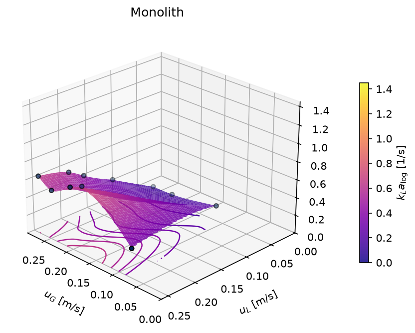
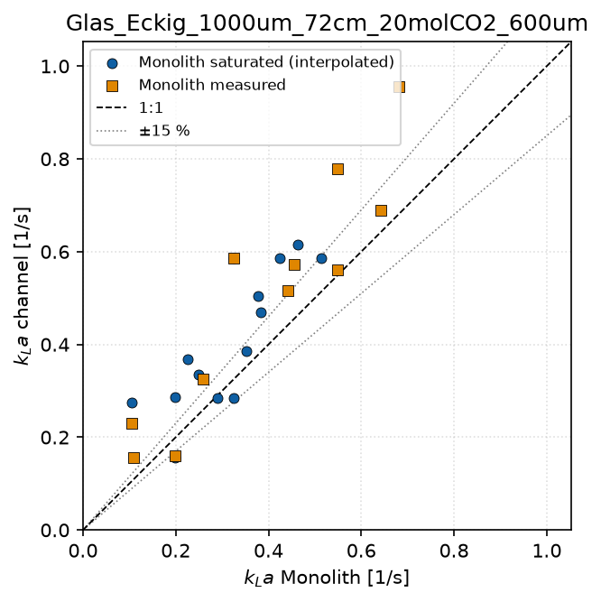

# 11 Monolith

`python monolith.py` evaluates measurements on a monolith via a gas balance
and compares them with a single channel.

## 11.1 Measurement data and settings

The measurement file (default `data/raw/Monolith_Messungen.csv`) contains
one row per operating point, separated by semicolons, with a decimal point:

| Column | Unit | Meaning |
|---|---|---|
| `V_L_L_h` | L/h | liquid volume flow |
| `V_G_in_L_h`, `V_G_out_L_h` | L/h | gas volume flow at inlet and outlet |
| `y_CO2_in`, `y_CO2_out` | % | CO2 fraction at inlet and outlet (analyser) |
| `T_in_C`, `T_out_C` | °C | temperature |
| `p_in_Pa`, `p_out_Pa` | Pa | absolute pressure |

Settings in `config.py`, section `MONOLITH`:

| Entry | Default | Meaning |
|---|---|---|
| `datei` (file) | `data/raw/Monolith_Messungen.csv` | measurement file |
| `n_kanaele` | 100 | number of channels |
| `d_kanal_m` | 1e-3 | side length of the square channels [m] |
| `laenge_m` | 1.0 | length [m] |
| `henry_ref_mol_m3_pa` | 3.3e-4 | Henry constant at 298.15 K [mol/(m³·Pa)] |
| `henry_dlnh_dt_k` | 2400 | temperature dependence d(ln H)/d(1/T) [K] |
| `vergleich_kanal` (comparison channel) | glass channel | channel name for the comparison; `None` = no comparison |
| `vergleich_modell` (comparison model) | `"yue_2007"` | additional model surface; `None` = none |

## 11.2 Calculation

All channels are considered together. Total cross-section $A = N d^2$,
volume $V = A\,L$.

**Superficial velocities:**

$$u_G = \dot V_{G,in}/A, \qquad u_L = \dot V_L / A$$

**Absorbed molar flux** from the gas balance, with $c_G = p\,y/(RT)$:

$$\dot n = \dot V_{G,in}\, c_{G,in} - \dot V_{G,out}\, c_{G,out}, \qquad
\dot n_{spec} = \dot n / V$$

**Equilibrium, residence time and outlet concentration:**

$$C^* = H(T)\,p\,y, \qquad t = L/u_L, \qquad C_{L,out} = \dot n\, t / (\dot V_L t)$$

**kLa** with logarithmic concentration difference
($\Delta C_{in} = C^*_{in}$, $\Delta C_{out} = C^*_{out} - C_{L,out}$):

$$k_La = \frac{\dot n}{V_L\,\Delta C_{log}}, \qquad
\Delta C_{log} = \frac{\Delta C_{in} - \Delta C_{out}}{\ln(\Delta C_{in}/\Delta C_{out})}$$

The Henry constant follows van't Hoff with the values from `MONOLITH`; they
differ slightly from those of the channel evaluation (3.36·10⁻⁴
mol/(m³·Pa), chapter 7.5).

**Saturated operating points:** if ΔC_out ≤ 0, the liquid is saturated at
the outlet and kLa cannot be determined (empty). In the supplied data this
applies to 14 of 25 operating points.

## 11.3 Outputs

In `ergebnisse/monolith/`:

| File | Content |
|---|---|
| `monolith_kennwerte.csv` | u_G, u_L, kLa, ṅ_spec, saturation flag per operating point |
| `kla_monolith.png`, `nspez_monolith.png` | 3D surfaces of the monolith |
| `kla_kanal.png`, `nspez_kanal.png` | the same quantities for `vergleich_kanal` |
| `kla_modell.png` | model surface (`vergleich_modell`) |
| `paritaet_monolith_kanal.png` | kLa of the channel against kLa of the monolith |

All 3D surfaces of a run have the same axis ranges and can be compared
directly. Language, format and sizes follow `STIL` (chapter 4.10).

{width=75%}

**Parity plot:**

- The channel values are interpolated to the operating points of the
  monolith.
- For saturated monolith points, the monolith value is interpolated from
  its own surface and marked separately.

{width=65%}

## 11.4 Interpretation

ṅ_spec of the channel is deliberately related to the whole channel volume,
as for the monolith (chapter 7.7). kLa of the channel, on the other hand,
is the log-mean over the active zone (chapter 7.6), kLa of the monolith a
log-mean over the whole reactor. With early saturation, the two kLa values
are therefore only comparable to a limited extent.
